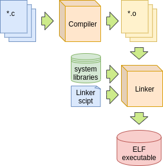
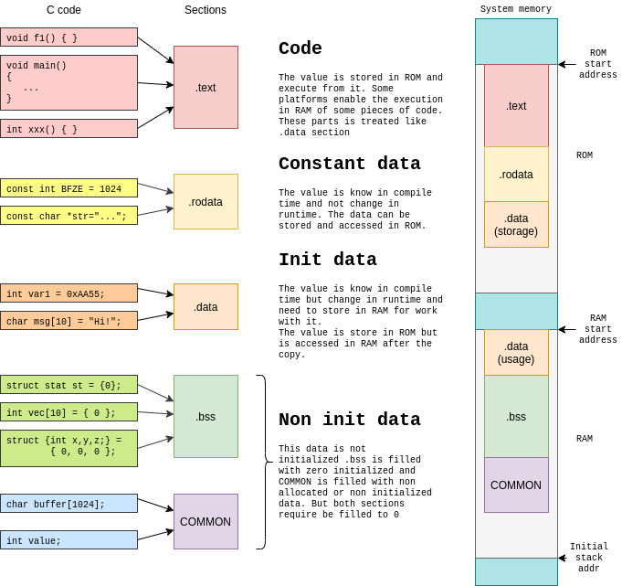

+++
title = "Armv7m Startup (2) - Linker script"
date = 2020-09-21T12:19:37-03:00
draft = false
categories = [ "Embedded", "Microcontrollers", "ARM" ]
keywords = ["Cortex-m","Microcontroller","ELF", "ARM", "Liner", "Compiler" ]
author = "Martin Ribelotta"
image = "img/articles/armv7m-boot/chinece-ancient-kanji.png"
+++

In the previous article, we learned how to write an efficient
startup code and play with the options of the compiler to produce
the desired code from C, but it is still necessary to put the code
in the correct memory locations to produce an executable suitable
for the cortex-m.

In the present article, we will work with the linker script to join all
our code into a single well structured executable.

<!--more-->



## The hex of scripts: Linker script

As we have previously read, the startup code needs to know some information
about the memory layout, specifically the start and end of
data and bss sections, and the start of initialized
data in ROM.

This information is provided by the linker when it combines all
object files to produce the final binary. But the memory layout
is very dependent of the platform, as not all devices have the
flash and RAM in the same locations.

The elegant way chosen by gcc and gnu tools to handle this is
through linker scripts; one or more text files describing the
particularities of memory layout, section placement and other
information required to produce the final executable.

### A fast review

The gnu toolchain build process is as follows:



 - All `*.c` files are built individually to an object file `*.o`. These files
   are a collection of sections containing binary data of diferent types:
    - The code of every C file generates the  `.text` section
    - The read only data generates the `.rodata` section
    - The non zero initialized data generates the `.data` section
    - The zero initialized data generates the `.bss` section
    - The non initialzed data generates the `COMMON` section. C
      standard mandates for it to be initialized as 0 like `.bss` section.
      Because of this, some compilers only generate a `.bss` section
      joining both `.bss` and `COMMON` sections.
 - The linker joins individual objects sections and puts joined sections
   in specific addresses depending on the linker script layout.
 - If we do not provide a linker script, the toolchain provides one by default.
   Normally, this script is not suitable to use in bare metal devices.



The linker script consists of commands to describe the placement of the
diferent sections in memory area.

### Basic linker script

In the next code, we can see a complete functional linker script compatible
with the startup exposed in the last sections:

```c
/* Start of section description layout */
SECTIONS
{
  . = 0x08000000; /* The dot is current address counter. */

  /* If you do not specify any, start at 0 */
  .text : {
    /* KEEP keyword is used to  ensure that symbols are not discarded if the 
       linker is instructed to remove unused symbols. */
    KEEP(*(.vector_core*)) /* Place .vector_core at start of ROM */
    *(.text)   /* Place all symbols in ".text" section */
    *(.text.*)  /* Place all symbols that start with section ".text.<any>" */
  }

  /* In many platforms, the linker script puts the .rodata in .text if
     the corresponding section does not exist */
  .rodata : {
    . = ALIGN(4); /* Ensure word alignment of sections */
    *(.rodata)
    *(.rodata*)
    . = ALIGN(4); /* Ensure word alignment of sections */
  }

  .init_array : {
    . = ALIGN(4); /* Ensure word alignment of sections */
    __init_array_start = .;
    /* SORT function sorts the symbols listed in alphabetical order.
       This is required to meet with the initialization order.
       All symbols are in the form of .init_array.0000_nameofsymbol
       when 0000 is replaced by a priority number that can be specified
       at compile time. */
    KEEP(*(SORT(.init_array.*)))
    KEEP(*(.init_array))
    . = ALIGN(4); /* Ensure word alignment of sections */
    __init_array_end = .;
  }

  _etext = .; /* You can define symbols with any expression using dot */

  . = 0x20000000;
  /* AT(expr) is used to specify load address */
  .data : AT(_etext) {
    _data = .;
    *(.data)
    *(.data*)
    . = ALIGN(4);
    _edata = .;
  }

  /* The function LOADADDR returns the load address of a specific section */
  _data_loadaddr = LOADADDR(.data);

  .bss : {
    . = ALIGN(4); /* Ensure word alignment of sections */
    _bss = .;
    *(.bss)
    *(.bss*)
    *(COMMON)
    . = ALIGN(4);
    _ebss = .;
  }

  /* You use prefixes like K to multiply by 1024 or M to multiply for 1048576 */
  _stack = 0x20000000 + 20K; /* Put the stack at end of ram (20K in this example) */
}
```

The only non-evident magic in this script is the `AT(_etext)` expression. This
instructs the linker to put the section in a specific load address, but for the
program this is mapped to current dot address. This is specifically designed
to place initialized data in ROM and copy this data to RAM at startup.

This linker script supposes that the rom memory starts at 0x08000000 and the ram
address starts at 0x20000000 and ends 8K later (the most common case being the bluepill
processor stm32f103cb)

### Improving the scripts with syntax sugar

We can improve the script adding more user friendly constants:

```c
ROM_BASE = 0x08000000;
RAM_BASE = 0x20000000;
RAM_SIZE = 20K;

/* Start of section description layout */
SECTIONS
{
  . = ROM_BASE;
  
  ...

  . = RAM_BASE;
  /* AT(expr) is used to specify load address */
  .data : AT(_etext) {
    _data = .;

  ...

  _stack = RAM_BASE + RAM_SIZE;
}
```

Or move this to another platform depend file:

```c
INCLUDE(memory.ld)

/* Start of section description layout */
SECTIONS
{
  . = ROM_BASE;
  ...
```

```c
/* Platform dependent memory.ld */
ROM_BASE = 0x08000000;
RAM_BASE = 0x20000000;
RAM_SIZE = 20K;
```

But the really nice way to put diferent sections in memory areas is
via the `MEMORY` command. You can replace the content of `memory.ld` with:

```c
MEMORY {
  rom rx : ORIGIN 0x08000000, LENGTH = 64K
  ram rwx : ORIGIN 0x20000000, LENGTH = 20K
}
```

Now the linker script needs some changes to use the memory regions
properly:

```c
INCLUDE memory.ld

SECTIONS
{
  .text : {
    KEEP(*(.vector_core*))
    *(.text)
    *(.text.*)
  } > rom /* fill rom memory area with .text section */

  .rodata : {
    . = ALIGN(4);
    *(.rodata)
    *(.rodata*)
    . = ALIGN(4);
  } > rom /* the second >rom appends the current block to previous block */

  .init_array : {
    . = ALIGN(4);
    __init_array_start = .;
    KEEP(*(SORT(.init_array.*)))
    KEEP(*(.init_array))
    . = ALIGN(4);
    __init_array_end = .;
  } > rom

  .data : {
    _data = .;
    *(.data)
    *(.data*)
    . = ALIGN(4);
    _edata = .;
  } > ram AT>rom /* AT>section is to append in load memory address mode */

  _data_loadaddr = LOADADDR(.data);

  .bss : {
    . = ALIGN(4);
    _bss = .;
    *(.bss)
    *(.bss*)
    *(COMMON)
    . = ALIGN(4);
    _ebss = .;
  } > ram

  /* ORIGIN(region) returns the address of memory region, LENGTH returns the length */
  _stack = ORIGIN(ram) + LENGTH(ram);
}
```

This trick has some advantages:

 - The linker can check automatically when a memory section is exhausted and end with an error
 - We don't need to maintain the dot pointer at the correct value
 - The linker script explain automatically where is your code
 - New versions of ld can display memory consumption for all memory areas in a user friendly manner

The last point can be illustrated with the followin command dump:

```
Memory region         Used Size  Region Size  %age Used
             rom:         220 B        64 KB      0.34%
             ram:          12 B        20 KB      0.06%
```

The next step is to build all with a Makefile script and produce the final
executable, suitable to be sent to the ROM memory...
