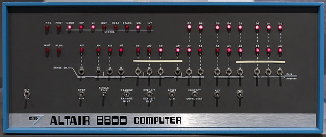
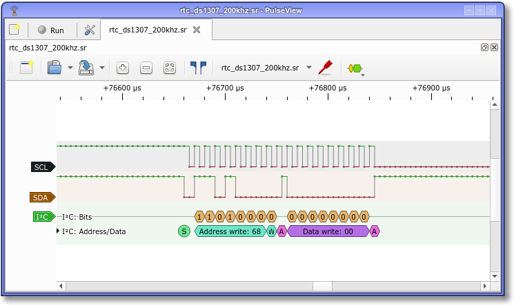
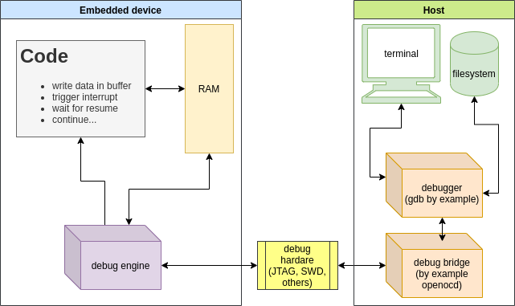
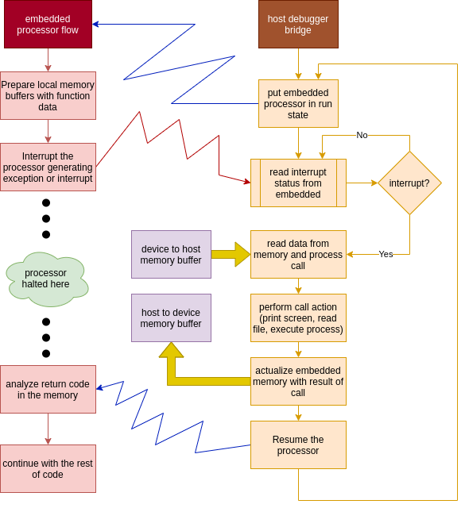
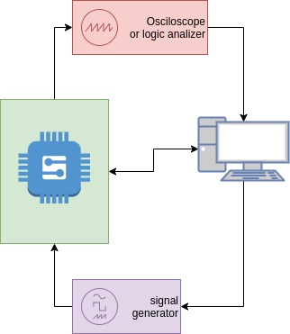

+++
title = "Remote control via semihosting"
subtitle = "Remote toy to play from your embedded"
date = 2020-11-02T13:25:55-03:00
draft = false
categories = [ "Embedded", "Microcontrollers", "ARM", "Make", "semihosting" ]
keywords = ["make", "gnu", "Cortex-m","Microcontroller","ELF", "ARM", "Compiler" ]
author = "Martin Ribelotta"
image = "img/articles/arm7m-semihosting/banner.jpg"
mermaid = true
+++

In this article, we communicate our embedded cortex-m with the PC during debug
session using a trick called semihosting. This trick provides access to host
IO (console, filesystem, shell execution) remotely from our embedded device.

<!--more-->



## Debug output and reason to do via semihosting

The most direct way to debug some embedded device is to produce a change in
observable output directly from code. Some techniques to do this will be:

### Led blinking, PWM or heart beat (change in the rhythm of blinking)

This technique is really easy to implement but the capable information to show
is very limited. In contrast, the resource consumption is quite small.



### Pin move and catch it using logic analyzer

Is a sophistication of the led blinking. This provides more accurate way to
show data from one or more pins. This need a logic analyzer and special
software to decode the signals.



In many cases, this is the preferred way to debug behavior of our system
because this is the less invasive way to detect the dynamic status of
involved signals and is universal of all scenarios.

The big issue of this method is the need to provide some physical access
to required signals that may be not possible in many cases (Imagine the
physical challenge to connect around 33 data signals of parallel bus with
your clock to an external debug probe)

### Serial output

Is an evolution of pin move. This technique move the debug pin as a serial
port output, in suitable form to connect directly to an UART into PC or an
serial to usb converter. This can be achieved using a hardware serial port
in the MCU or via software emulation using timers, interrupts or DMA streams.

This enable to send any type of data. Normally we want to send a text in ascii
format in a human readable way but we can implement some compression and use
an special program in the receiver side to show in a terminal program or some
like this.

This is more expensive in hardware (or cpu time if we decide emulate the serial
in software) than the simple pin movement but provides a more sophisticated
interface.


### Debug channel facilities

Some debugger systems offer facilities to inspect memory and present the
contents in human readable way. By example, we can trigger a memory dump in
specific area when we encounter a breakpoint in the code, and produce,
programmatically these breakpoints after the inspectable memory region was
filled with your message.



The last option is the root of semihosting techniques, not only for ARM, but
also for any architecture capable to be debugged and trigger a software
breakpoint, like MIPS, RISC-V, AVR, xtensa, nios, xcore, and virtually all
recently cores with integrated debugger

Semihosting technique have many advantages over other methods:

 - We can use only one cable (the debugger cable)
 - We have access to many functions not only console print and write. Also,
 using semihosting we can write and read files from your filesystem (with
 permission from the user that actually runs the corresponding debug bridge
 like openocd) or execute host binaries via `system` call
 - The interface and hardware involved is common to all platform independent
 of your vendor (at least in cortex-m and risc-v). Programming this with cares,
 we can run the same semihosting code in any cortex-m platform.

But not all is good, some disadvantages appear if we chose this as debug
engine:

 - When we have in system call (like write, read or printf) the processor is
 halted until the host end to process the call. If we code is heavy time
 dependant, may break your debug experience too much.
 - The call consume variable time depending of the power of host, the operation
 requested and (firstly) the debug interface speed. Again, the call latency may
 broke the system and invalidate your debug experience.
 - The amount of ram is quite small but normally, the semihosting is
 implemented using c libraries like newlib or picolibc and these libraries may
 consume more than  simple led blinking.
 - We need a host connected to the device when your software is running.

Having said that, the semihosting debug techniques is powerfully in many cases
and the potential problems can be avoided or mitigated with a careful debug
planning.

## Semihosting technical background

The magic beside of semihosting is only the ability to inform to the debugger
in the host when the processor suffer a software interrupt, enabling the host
to catch it using the hardware debugging system (half inner the CPU chip, half
in the host machine in form of software stack)



The steps was explained below:

 - The device and the host are communicated via debug interface controlled in
 the host, by the debug bridge (software like openocd, stlink or jlinkutils)
 using some interface like JTAG, SWD, or other, normally as a specialized
 hardware interface (usb to jtag chips, parallel port connection, or other
 hardware that enable communication to the debug interface in the device)
 - These software poll the status of the device in regular periods and check the
 CPU state for some special conditions triggered in semihosting call.
 - In the device, before we do semihost call, need to perform several actions:
   - Prepare a memory buffer with the corresponding data and configure the CPU
   registers to point to this data block. Normally, in another record we need
   to put the system call number (an integer that indicates the action to be
   performed)
   - When the device environment is ready, the CPU perform an action that
   trigger some hardware exceptions or interrupt that can be catched from the
   debug subsystem internally on the chip. In cortex-m this imply a special
   instruction called `bkpt #number` with an special value in `#number`. In
   other architectures the action may imply trigger an interrupt or put some
   special value in memory mapped register but the concept is the same. This
   halt the CPU (or, at least the core that generate the exception)
 - When the debug bridge detect the halt condition caused by a debug exception,
 notify the host for halt CPU state via debug interface (JTAG, SWD, etc) and
 select the type of call using the number previously stored in an special CPU
 register. If the call need more data (like the previously write buffer), the
 host read from the device to the host these data and use this to perform the
 requested action.
 - Now, with any required data copied from device to host, the this perform the
 requested action. This may imply, write in screen, read from file or standard
 input, get system information or any function provided by the debug bridge
 software running in the host. In some cases, the debug bridge software can
 communicate with other software via socket or other inter process mechanism
 to delegate the actions in specialized software or plugin.
 - When the host action is finished, the result of these action is packed and
 sended to the device if required (not all semihost call need returned data).
 The data is write in special buffer in the device via debug interface actions
 and, finally, the halted CPU is resumed when the environment is actualized.

The semihosting action will be transparent for the device. This imply, by
example, when we perform a file read in semihosting mode, the behavior will be
exactly like a file read locally.

## The concrete ARMv7M (aka cortex-m) semihosting

The concrete implementation of semihosting in ARMv7M (aka cortex-m) is quite
simple. Only need to put the number of the call in r0 and the pointer to
parameter array in r1. The number and type of parameter array is call
dependent. When the semihosting resume the CPU execution, a return code is put
in r0. If the host need to pass other information (like file data block) the
function call will be provide a memory buffer pointer as an one of the
parameters passed in the array pointed by r1.

```asm
; file: sys_semihost.S 
; @csignature: int sys_semihost(int, void*)
; @brief: Semihosting call
; @param  [r0]: System call number
; @param  [r1]: Pointer to parameters
; @return [r0]: System call result
sys_semihost:
	bkpt #0xab
	bx lr
```

You may call the code in your C/C++ program as:

```c
extern int sys_semihost(int req, void *args)

void semihost_puts(const char *str)
{
	sys_semihost(0x04, (void*) str);
}
```

In this example, the function invoked is `SYS_WRITE0` that is represented with
the code `0x04`. This function write a zero terminated string on stdout. The
memory block containing the zero terminated string is passed in r1 (the second
parameter)

The return value (in r0) is undefined and may be corrupted by the semihost
operation.

Another example is the case of an `open` syscall that open a file and return
an integer used as reference to these file in subsequent calls of `write`
and `read`:

```c
#include <string.h>

extern int sys_semihost(int req, void *args)

int semihost_open(const char *name, const char *mode)
{
	int params[] = {
		(int) name, (int) mode, strlen(mode)
	};
	return sys_semihost(0x01, params);
}
```

In this case, r0 contains the syscall code 0x1 corresponding to `SYS_OPEN`
function and r1 contain pointer to array of tree integers containing the
pointer to the file name at index 0, the pointer of string mode at index 1 and
the size of string mode in index 2.

On finish, r0 contains an integer number representing the file descriptor for
refer the new opened file, or -1 in case of error.

A complete list of semihosting system calls and the required parameters can be
found in [armcc manual from arm site](https://developer.arm.com/documentation/dui0471/g/Semihosting/Semihosting-operations?lang=en)

## Another history: RISC-V Semihosting

The semihosting technique is quite simple to implement. we only need a debug
capability in your processor, a little memory area of exchange, and a some
mechanism to catch with the debugger.

For this, is not strange that practically all recent architectures have 
semihosting support. The rising RISC-V is not the exception.

In short, the treatment is much similar that ARM semihosting. The r0 and r1
is replaced by x10 and x11 respectively (argument 0 and argument 1 in risc-v
call convention), and `BKPT` is replaced by instruction `EBREAK` that can be
detected by the debugger.

Last but not least, `EBREAK` is not only used for semihosting interruptuion,
also is used to mark unreachable code by some compilers (gcc) or inserted as
software breakpoint by some debuggers (gcc, ldb, etc). For this reason, the
semihosting encode a tow NOP instructions with special encoding in order to
mark these particular `EBREAK` occurrence for the debugger.

```asm
; file: sys_semihost.S 
; @csignature: int sys_semihost(int, void*)
; @brief: Semihosting call
; @param  [x10]: System call number
; @param  [x11]: Pointer to parameters
; @return [x10]: System call result
sys_semihost:
    slli x0, x0, 0x1f   # Entry NOP
    ebreak              # Break to debugger
    srai x0, x0, 7      # NOP encoding the semihosting call number 7
	ret
```

The corresponding documentation of this technique is found in
[RISC-V ISA manual](https://github.com/riscv/riscv-isa-manual/blob/master/src/rv32.tex#L1346)
and is discuted in
[this RISC-V debug specification issue](https://github.com/riscv/riscv-debug-spec/pull/185)

## Semihosting with newlib: The easy way

A minimal semihosting framework must be provide a console IO, file IO and not
so much more. Is not difficult to implement this using the above documents from
ARM and some little C and ASM code but the gcc arm embedded, and specifically
the libc bundled on it (newlib) provides many of the work with a funny and
familiar interface.

### RDIMON an newlib with gcc

Originally, RDIMON was a library bundled with ancient ARM port of newlib
(BTW, newlib is the standard c library for embedded and resource constraint
systems) as part of libgloss, a little piece of code dedicated to implements
the system dependent part of the newlib. This implement the Angle software
procedure call.

The original idea was the vendor provides a piece of code called monitor (maybe
in ROM or FLASH into board) and this catch the debug monitor interrupt,
performing the communication between the embedded device and software daemon in
the host system, normally via serial port network or other communication
channel. This piece was baptized by ARM as Angle debug monitor or ADB

With the advance of the technology, the monitor was replaced by dedicated
hardware called debug macrocell and finally the interface  communication to the
host transform in JTAG or SWD but the original idea work in same way, and the
name RDIMON for these library is maintained for compatibility.

These library was update with newer ARMv6 and ARMv7 debug interface enabling
modern semihosting interactions and many JTAG/SWD controllers like openocd
JLink or stlink software provides all of the interfaces specified in RDIMON
API.

By the way, the newlib bundled with gcc in `gcc arm embedded` distribution
(from ARM and others third part vendors) implements as a library all things
needed to use semihosting as a stdio output/input.

This imply that use `printf/scanf` style C functions and show the result in
your debugger console (ok, sorry, in the output of your debug bridge like
openocd or jlink)

The arm gcc embedded distribution includes librdimon.a and librdimon_nano.a
out of the box (the first is the full fledged variant and the *_nano contain
the memory footprint reduced with limited functionality)

For use this, we only need to add the link flag to final phase:

```sh
arm-none-eabi-gcc -o firmare.elf main.o other.o module.o -lc -lrdimon
```

Or for the nano version:

```sh
arm-none-eabi-gcc -o firmare.elf main.o other.o module.o -lc_nano -lrdimon_nano
```

If we want gcc to automatically choose the correct library (nano or normal)
we need to use specs command:

```sh
arm-none-eabi-gcc -o firmare.elf main.o other.o module.o -specs=rdimon.specs
```

The specs mechanism invoke a bundled specsfile (*.specs) that contains the
correct flags and some information to chose the right library version depending
of the previous linker flags. Additionally, specfiles contains some flags used
by the compiler (like some defines for check the configuration in your code)

### Using previous make script

In [previous article](/blog/2020/09/30/armv7m-startup-make/) we make a generic
Makefile to build our project. This provides a way to add libraries for linker
scripts but not for add specfiles. To fix it, we need to add some capabilities
to handle specfiles:

```Makefile
TARGET=firmware
SOURCES=$(wildcard src/*.c)
LIBPATH=lib
LIBS=
LDSCRIPTS=link.ld
SPECS=rdimon
OUT=out

# ...more script...

# Linker flags
LDFLAGS=$(ARCH_FLAGS)
LDFLAGS+=-nostartfiles
LDFLAGS+=$(addprefix -L, $(LIBPATH))
LDFLAGS+=$(addprefix -l, $(LIBS))
LDFLAGS+=$(addprefix -T, $(LDSCRIPTS))
LDFLAGS+=$(addsuffix .specs, $(addprefix -specs=, $(SPECS)))

# ...rest of code...
```


Now, we put this code in your main and can use semihosting printf in full
form:

```c
#include <stdio.h>

extern void initialise_monitor_handles(void);

int main()
{
    initialise_monitor_handles(); /* Need for internal initialization */
    printf("Hello world\n");
    printf("Compiled with %s\n", __VERSION__);
    printf("At %s %s\n", __DATE__, __TIME__);
    return 0;
}
```

We can run `program` to flash the MCU but the best way to show the program
running is to put the `openocd` in semihosting mode and run the program without
exiting.

For this we need to add this rule to `Makefile`

```Makefile
# ...openocd flag sections...
OOCD_FLAGS:=-f interface/stlink.cfg -f target/stm32f1x.cfg

OOCD_CMDS:=-c "init"
OOCD_CMDS+=-c "reset halt"
OOCD_CMDS+=-c "program $(TARGET_ELF) verify reset exit"

OOCD_RUN_CMDS:=-c "init"
OOCD_RUN_CMDS+=-c "reset halt"
OOCD_RUN_CMDS+=-c "program $(TARGET_ELF) verify"
OOCD_RUN_CMDS+=-c "reset halt"
OOCD_RUN_CMDS+=-c "arm semihosting enable"
OOCD_RUN_CMDS+=-c "resume"

program: $(TARGET_ELF)
	$(Q)$(OOCD) $(OOCD_FLAGS) $(OOCD_CMDS)

run: $(TARGET_ELF)
	$(Q)$(OOCD) $(OOCD_FLAGS) $(OOCD_RUN_CMDS)

```

Now, we run the software using `make run`, this program the target, and start
openocd and the result may be similar to this:

```
$> make run
xPack OpenOCD, 64-bit Open On-Chip Debugger 0.10.0+dev (2019-07-17-11:25)
Licensed under GNU GPL v2
For bug reports, read
        http://openocd.org/doc/doxygen/bugs.html
debug_level: 0

target halted due to debug-request, current mode: Thread 
xPSR: 0x01000000 pc: 0x08000088 msp: 0x20005000
target halted due to debug-request, current mode: Thread 
xPSR: 0x01000000 pc: 0x08000088 msp: 0x20005000
** Programming Started **
** Programming Finished **
** Verify Started **
** Verified OK **
target halted due to debug-request, current mode: Thread 
xPSR: 0x01000000 pc: 0x08000088 msp: 0x20005000
semihosting is enabled

---------------------------------------------------
Hello world
Compiled with 9.2.1 20191025 (release) [ARM/arm-9-branch revision 277599]
At Nov  9 2020 12:54:14
```

we can peek [the complete makefile from here](https://gist.github.com/martinribelotta/06f8a4d43286933902e27da4fd80d810):



### Some utilities for debugging

Semihosting enables very interesting posibilities like automatic memory dump in
failure or testbench execution over hardware in the loop.

By example, this simplest programm dump entire memory suposing this start at
`0x20000000` and have `8K` bytes.

```c
#include <stdio.h>

extern void initialise_monitor_handles(void);

int main() {
    initialise_monitor_handles();
    FILE *fd = fopen("memory.bin", "wt");
    if (fd) {
        if (fwrite((void*) 0x20000000, 8192, 1, fd) == -1) {
            perror("writing memory.bin");
        } else
            puts("Memory dump end ok");
        fclose(fd);
    } else
        perror("open memory.bin");
    return 0;
}
```

Or this other that send a previos prepared data file to the serial port at:

```c
#include <stdio.h>

// GPIO address
#define OUT (*((volatile unsigned int*)0xE0001C00))

extern void initialise_monitor_handles(void);

static char buffer[512];

int main() {
    initialise_monitor_handles();
    // You need to initialize GPIO here
    FILE *fd = fopen("data.bin", "rb");
    if (fd) {
        while (!feof(fd)) {
            int readed = fread(buffer, sizeof(buffer), 1, fd);
            for (int i=0; i<readed; i++)
                OUT = buffer[i];
        }
        fclose(fd);
    } else
        perror("open memory.bin");
    return 0;
}
```

### Some security warns

Semihosting is a good tool to work with it, but imply some security risks to
consider. Semihosting have entire control of your filesystem, at least with the
permission that openocd (or equivalent software) is running, and, at least
teorically your firmware can create, remove or rename any files in the
filesystem area where have permission.

Some scenarios of risk is:

 - On windows, you can access any location in your filesystem. Take care with
 it if your semihosting write or rename some files
 - The `system` call provides remote execution of any script or binary in the
 security ring where openocd is execute
 - The function `unlink` is really harmfull, you can remove any file without
 confirmation or prevention if openocd have permission of write over it
 - The `open/write` pair of functions need to take care for the place to write.
 If you are search for a temporary directory, `/tmp/` is a secure place to do,
 and more scure is usage of `tmpname` function for obtain a secure filename in
 secure place.

All of these errors may be avoided executing openocd with correct permissions
but this is not possible in all operating systems.

### Last idea, hardware in the loop verification

Design and testing in embedded is hard, varios order of magnitude more hard
than an entire PC based software, because the behavior is dependent on many
external conditions and generate varios external observable events.

During the development process, you may require to prove your engine with the
real board connected to the system generating specific events in the input and
sensing specific behavior in the output.

Normally, this process involve some technical equipment and one or more humans
due to run the procedure manually. This is expensive and error prone, in vast
majority of cases via human errors.

The ideal way of co-verification of software-firmware-hardware is an automated
test with an special mount using debugger PC, signal generators, data
adquisition systems and some scripts to automatize the process.

In this scenario, the semihosting can help controlling entire process via the
firmware in the device.



This technique is quite amplius and require own article, but the idea is very
powerful and enables continuous integration for complex hardware.

We read in the following article
