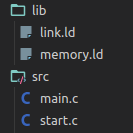
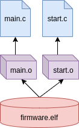
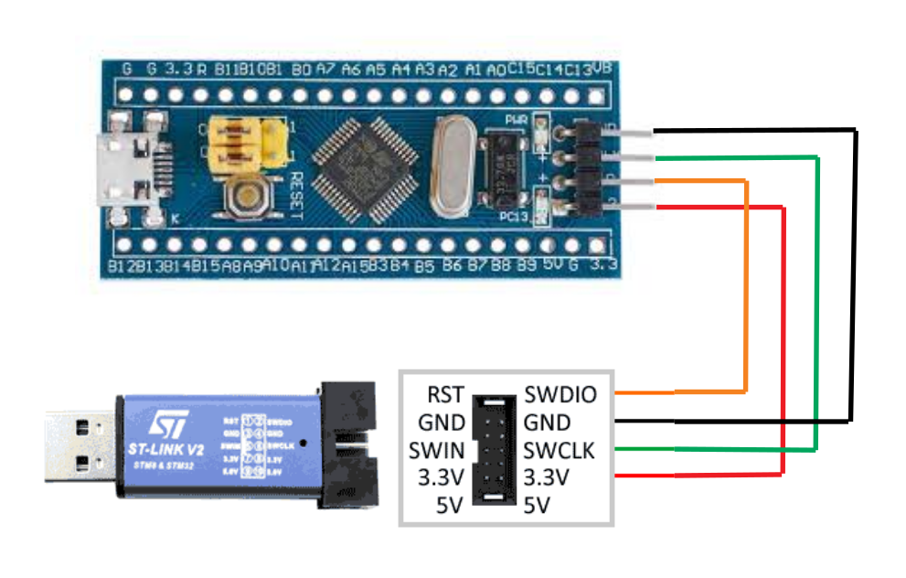
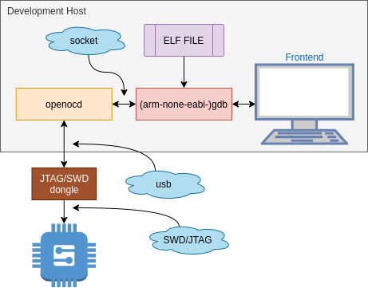

+++
title = "Armv7m Startup (3) - Make and build process"
date = 2020-09-30T22:00:00-03:00
draft = false
categories = [ "Embedded", "Microcontrollers", "ARM", "Make" ]
keywords = ["make", "gnu", "Cortex-m","Microcontroller","ELF", "ARM", "Compiler" ]
author = "Martin Ribelotta"
image = "img/articles/armv7m-boot-3/self-made-man.png"
+++


In the previous articles, you learned how to write initialization code and put
it in the correct place in the processor memory.
Now you will learn how to generate the proper binary for send to ROM and will
see various tricks to simplify your live with gnu make and Makefile.

<!--more-->



## Reviewing what has been done up to this point

You have done a C source to startup your cortex-m processor in vendor neutral
way, you have a linker script to place all code and data in particular areas of
your memory and little platform dependent memory layout specification file.

Now you need to compiler all and put it in a binary file suitable to write in
memory (flash, rom, eeprom or any non volatile memory from your device)

So far, you have this structure of files:



with these contents:
 - `main.c`: A simple empty main program `int main() { return 0; }`
 - `start.c`: [The previous made startup code](/blog/2020/09/05/armv7m-startup/)
 - `link.ld`: The file created in [previous article](/blog/2020/09/21/arm7m-startup-ldscript/)
   whit the instructions to place code in memory
 - `memory.ld`: Device dependent memory map used by `link.ld`

The simple way to do this is invoking the compiler directly:

```bash
arm-none-eabi-gcc -mcpu=cortex-m3 -mthumb -Og -g3 -o src/main.o -c src/main.c
arm-none-eabi-gcc -mcpu=cortex-m3 -mthumb -Og -g3 -o src/start.o -c src/start.c
arm-none-eabi-gcc -o firmware.elf -nostartfiles -mcpu=cortex-m3 -mthumb src/main.o src/start.o -lnosys -Llib -Tlink.ld
```

And you can write better bash script with variables:

```bash
BINARY=firmware.elf
CC=arm-none-eabi-gcc
LD=arm-none-eabi-gcc
ARCH=-mcpu=cortex-m3 -mthumb
CFLAGS=$ARCH -Og -g3
LDFLAGS=$ARCH -nostartfiles -lnosys -Llib -Tlink.ld
$CC $CFLAGS -o src/main.o -c src/main.c
$CC $CFLAGS -o src/start.o -c src/start.c
$LD -o $BINARY src/main.o src/start.o $LDFLAGS
```

But this not scale well with large project because build all files all times.

## Makefile to the rescue

For this purpose, a better script tool is make, an ancient utility from old unix
systems in the category of "dependency management tool". Precisely, "make" reads
a file with rules between target and dependencies and executes the specified
actions to obtain each target as long as the dependencies are newer than the
existing objective (or that objective does not exist)

 1. Read makefile file, and find first dependency in the form of:
    ```
    target: dependency other-dependency more-dependencies
     <-- tab --> command to generate "target"
     <-- tab --> other command to generate the target
     <-- tab --> More commands to generate the target
    ```
    The `<-- tab -->` is character 0x08 or `TAB`. This is very important and
    major smart editors take care with this... you not replace `TAB` by spaces,
    spaces produce malformed Makefile and the program fail with an error if
    encounter other character instead of TABs as first char in the command list.
  2. Check if the dependency exist and not have any dependency
  3. If the dependency not exist, find a rule to create it and perform the
     step 2 in this dependency
  4. If the dependency exist, and is newer than the target
     perform the commands to obtain the target
  5. If the target exist and is newer than any dependency end with success

As you see, the make behavior is performed in tree over all dependencies and
sub-dependencies for all targets.

For our example, the file dependency tree is like this:



With this, you can write our first Makefile:

```makefile
all: firmware.elf

src/main.o: src/main.c
	arm-none-eabi-gcc -mcpu=cortex-m3 -mthumb -Og -g3 -o src/main.o -c src/main.c

src/start.o: src/start.c
	arm-none-eabi-gcc -mcpu=cortex-m3 -mthumb -Og -g3 -o src/start.o -c src/start.c

firmware.elf: src/main.o src/start.o
	arm-none-eabi-gcc -o firmware.elf -nostartfiles -mcpu=cortex-m3 -mthumb src/main.o src/start.o -lnosys -Llib -Tlink.ld

clean:
	rm src/main.o src/start.o firmware.elf
```

Now, when you modify `main.c` only this file is recompiled and all objects was
linked again. The way to recompile all is delete all `*.o` files and the `*.elf`
file. This is performed with the target `clean`.

A cool thing of make, is the existence of `PHONY` targets. Target with 
convenient name but no represent any files, only a dependency step, like `all`
target that acts as an alias for real target, or only a convenient name to
perform some actions like `clean` that remove all generated files.

The way to stop the `clean` target to work is create an empty file with this
name (`clean`, without extension) and, when you try to run `make clean` the
make, return without actions because the "file" is already created and
actualized.

To prevent this, all "phony" rules need to mark as PHONY using this line:

```Makefile
.PHONY: all clean
```

After this, the existence of file with name of `all` or `clean` is ignored and
the commands if this rules is executed ever.

## Use wildcards and variables to simplify the makefile

Like shell script, the Makefile file, can be simplified with variables, but
unlike bash script you can use wildcards to match multiple files with one rule
(yeeeeeessss, bash can do this using the respective wildcards but not without
specify a complex script to track dependencies)

```Makefile
TARGET=firmware.elf
OBJECTS=src/main.o src/start.o

CROSS=arm-none-eabi-
CC=$(CROSS)gcc
LD=$(CROSS)gcc

ARCH_FLAGS=-mcpu=cortex-m3 -mthumb
CFLAGS=$(ARCH_FLAGS) -Og -g3
LDFLAGS=$(ARCH_FLAGS) -nostartfiles -lnosys -Llib -Tlink.ld

all: $(TARGET)

%.o: %.c
	$(CC) $(CFLAGS) -o $@ -c $<

$(TARGET): $(OBJECTS)
	$(LD) -o $@ $^ $(LDFLAGS)

clean:
	rm $(OBJECTS) $(TARGET)

.PHONY: all clean
```

In this version, we can take advantages of wildcard to specify rules.

The construction

```Makefile
%.o: %.c
	$(CC) $(CFLAGS) -o $@ -c $<
```

Is specified for all pair of `*.o` files that depends on corresponding `*.c`
file. The tokens `$@` and `$<` is the form to refer the target and the
dependency list in the command list.

This is effectively expanded to:

```Makefile
src/main.o: src/main.c
	arm-none-eabi-gcc -mcpu=cortex-m3 -mthumb -Og -g3 -o src/main.o -c src/main.c

src/start.o: src/start.c
	arm-none-eabi-gcc -mcpu=cortex-m3 -mthumb -Og -g3 -o src/start.o -c src/start.c
```


A disadvantage of this script is that you must specify the name of the *.o files
instead of your sources *.c. This can be solved using some make functions...

## Make make great (again?)

Other tricks of make is the ability to call some processing functions inside
the script like file find with sh wildcards, string substitutions and other
happy and funny eggs:

```Makefile
TARGET=firmware.elf
SOURCES=$(wildcard src/*.c)
LIBPATH=lib
LIBS=nosys
LDSCRIPTS=link.ld

OBJECTS=$(patsubst %.c, %.o, $(SOURCES))

CROSS=arm-none-eabi-
CC=$(CROSS)gcc
LD=$(CROSS)gcc

ARCH_FLAGS=-mcpu=cortex-m3 -mthumb

CFLAGS=$(ARCH_FLAGS) -Og -g3

LDFLAGS=$(ARCH_FLAGS)
LDFLAGS+=-nostartfiles
LDFLAGS+=$(addprefix -l, $(LIBS))
LDFLAGS+=$(addprefix -L, $(LIBPATH))
LDFLAGS+=$(addprefix -T, $(LDSCRIPTS))

all: $(TARGET)

%.o: %.c
	$(CC) $(CFLAGS) -o $@ -c $<

$(TARGET): $(OBJECTS)
	$(LD) -o $@ $^ $(LDFLAGS)

clean:
	rm -fr $(OBJECTS) $(TARGET)

.PHONY: all clean
```

The first interesting function is `wildcard`, this perform like `ls` in bash,
and make replace this occurrence with a list of **existing** file names that
match the wildcard specified:

```Makefile
SOURCES=$(wildcard src/*.c)
```

Is transformed by make in to:

```Makefile
SOURCES=src/main.c src/start.c
```

And, with `patsubst` you can obtain the corresponding names of object files:

```Makefile
OBJECTS=$(patsubst %.c, %.o, $(SOURCES))
```

Is substituted by make for:

```Makefile
OBJECTS=src/main.o src/start.o
```

And yes, you can use this as a list of final target dependency.

Other interesting function is `addprefix` that is used to improve libraries,
library path, and linker script handling:

```Makefile
LIBPATH=lib
LIBS=nosys
LDSCRIPTS=link.ld

...
LDFLAGS=$(ARCH_FLAGS)
LDFLAGS+=-nostartfiles
LDFLAGS+=$(addprefix -l, $(LIBS))
LDFLAGS+=$(addprefix -L, $(LIBPATH))
LDFLAGS+=$(addprefix -T, $(LDSCRIPTS))

```

In this case, when make found this `$(addprefix -l, $(LIBS))`, append `-l` to
all wolds in `$(LIBS)` variable. If LIBS contains `nosys` this is expandend to:

```Makefile
LDFLAGS+=-lnosys
```

If in addition, LIBS contains `nosys nano m` this expands to:

```Makefile
LDFLAGS+=-lnosys -lnano -lm
```

Linking all libraries in this binary.

## Moving generated files to own directory

If you see, the compilation process generate an `*.o` file for every `*.c` file.
This increase rapidly the garbage in the source tree when you compile a project
and the only form to maintain the code clean is to track all `*.o` files and
remove this in clean phase.

Is desirable to move all generated files to own directory in order to maintain
the source code clean in any build conditions.

To do this, you need some magic around makefile:

```Makefile
TARGET=firmware
SOURCES=$(wildcard src/*.c)
LIBPATH=lib
LIBS=nosys
LDSCRIPTS=link.ld
OUT=out

OBJECTS=$(addprefix $(OUT)/, $(patsubst %.c, %.o, $(SOURCES)))
TARGET_ELF=$(addsuffix .elf, $(addprefix $(OUT)/, $(TARGET)))

CROSS=arm-none-eabi-
CC=$(CROSS)gcc
LD=$(CROSS)gcc

ARCH_FLAGS=-mcpu=cortex-m3 -mthumb

CFLAGS=$(ARCH_FLAGS) -Og -g3

LDFLAGS=$(ARCH_FLAGS)
LDFLAGS+=-nostartfiles
LDFLAGS+=$(addprefix -l, $(LIBS))
LDFLAGS+=$(addprefix -L, $(LIBPATH))
LDFLAGS+=$(addprefix -T, $(LDSCRIPTS))

all: $(TARGET_ELF)

$(OUT)/%.o: %.c
	mkdir -p $(dir $@)
	$(CC) $(CFLAGS) -o $@ -c $<

$(TARGET_ELF): $(OBJECTS)
	mkdir -p $(dir $@)
	$(LD) -o $@ $^ $(LDFLAGS)

clean:
	rm -fr $(OUT)

.PHONY: all clean
```

Now, the target is not specified as an *.elf file, instread of it, TARGET is
now a generic name suitable to convert to an *.elf, *.bin, *.hex or whatever
you need:

```Makefile
TARGET=firmware
```

In addition to this, the function `addsuffix` is introduced, this is analog
to `addprefix` but prepends the text instead of append:

```Makefile
OBJECTS=$(addprefix $(OUT)/, $(patsubst %.c, %.o, $(SOURCES)))
TARGET_ELF=$(addsuffix .elf, $(addprefix $(OUT)/, $(TARGET)))
```

In the rule section, you need to specify `$(OUT)/%.o` as a wildcard target
and take care with directory creation in the $(OUT) directory.

By example, if you try to compile `src/modules/mod1/mymod.c` the compile
process need to create `out/src/modules/mod1/` to leave `mymod.o` result. This
is the purpose of the line `mkdir -p $(dir $@)` create directory obtained by
`$(dir ...)` function from the target in secure way (flag -p). If the directory
exist, not fail, and if the subdirectories not exist create all parts needed.

```Makefile

all: $(TARGET_ELF)

$(OUT)/%.o: %.c
	mkdir -p $(dir $@)
	$(CC) $(CFLAGS) -o $@ -c $<

$(TARGET_ELF): $(OBJECTS)
	mkdir -p $(dir $@)
	$(LD) -o $@ $^ $(LDFLAGS)

clean:
	rm -fr $(OUT)

.PHONY: all clean
```

At the end, the `clean` target is substantially simplified, now only need to
remove `$(OUT)` directory.

## Sound of (make) silence

The output produced by make in the terminal is very verbose, this includes
the complete command with all parameters, extra commands like mkdir and
others output like directory changes.

It is very inconvenient when you only need to view the progress of the process
(hey! good name for a 60's music)

To avoid this, if you prepends `@` to any command it is silently executed but
the command not appear in your terminal.

With this, the Makefile part of rules can change like that:

```Makefile
$(OUT)/%.o: %.c
	@echo CC $<
	@mkdir -p $(dir $@)
	@$(CC) $(CFLAGS) -o $@ -c $<

$(TARGET_ELF): $(OBJECTS)
	@echo LD $@
	@mkdir -p $(dir $@)
	@$(LD) -o $@ $^ $(LDFLAGS)

clean:
	@echo CLEAN
	@rm -fr $(OUT)

.PHONY: all clean
```

In addition, you can use now, the command `echo` to show a custom message to the
console indicating the actual phase of compiler...

Now, the output of makefile is like this:

```
$> make
CC src/main.c
CC src/start.c
LD out/firmware.elf
```

Much easy to seek the output!

## Sorry no sorry, I need the verbosity back

In some cases, the silent behavior is a pain in the ass, specially when you are
debugging the compilation process and need to known specifically what is the command
executed in reality.

To maintain the both word, you need to use some variable expansion trick:

```Makefile
TARGET=firmware
SOURCES=$(wildcard src/*.c)
LIBPATH=lib
LIBS=nosys
LDSCRIPTS=link.ld
OUT=out
VERBOSE=n  # <-- Addition here!
...
ifeq ($(VERBOSE),y)
Q=
else
Q=@
endif

all: $(TARGET_ELF)

$(OUT)/%.o: %.c
	@echo CC $<
	@mkdir -p $(dir $@)
	$(Q)$(CC) $(CFLAGS) -o $@ -c $<

$(TARGET_ELF): $(OBJECTS)
	@echo LD $@
	@mkdir -p $(dir $@)
	$(Q)$(LD) -o $@ $^ $(LDFLAGS)

clean:
	@echo CLEAN
	$(Q)rm -fr $(OUT)

.PHONY: all clean
```

Now, the selectable lines is pretended with `$(Q)` variable (award for my name
originality) and this variable is assigned/not-assigned with `@` character
depending of the contents of `VERBOSE` variable (`y` or whatever, by default
the variable is `n`)

To regain the verbose behavior your only need to override the variable in the
command line:

Silent output:

```bash
$> make all
CC src/main.c
CC src/start.c
LD out/firmware.elf
```

Verbose output:

```bash
$> make all VERBOSE=y
CC src/main.c
arm-none-eabi-gcc -mcpu=cortex-m3 -mthumb -Og -g3 -o out/src/main.o -c src/main.c
CC src/start.c
arm-none-eabi-gcc -mcpu=cortex-m3 -mthumb -Og -g3 -o out/src/start.o -c src/start.c
LD out/firmware.elf
arm-none-eabi-gcc -o out/firmware.elf out/src/vectors_vendor.o out/src/main.o out/src/start.o -mcpu=cortex-m3 -mthumb -nostartfiles -lnosys -Llib -Tlink.ld
```

Now, the code is contained in `*.elf` file, this is not directly the image in
memory but contains the code sparse in various sections and is suitable to
program the processor using tools like openocd or gdb. This is sufficient to run
simple program in the MCU but lack the ability to handle the platform specific
interrupts (like uart tx/rx, dma, or other peripherals)

This is time to probe the firmware in real hardware

## These cheap and blue trinket...

A good cortex-m platform to test the code is the omnipresent bluepill board, a
little pcb in dip40 containing a cheap stm32f103c8t6 with 64K of flash and 20K
of ram, 8MHz/32.768KHz crystals, 3.3v regulator and usb connector attached to
the MCU. This board can be obtained in eBay for around 2usd.

The other instrument required is the programmer. In the same line to extreme
cheap tools, the choice is stlink v2 in chinese version (with questionable
legality about STMicroelectronics intellectual property), a very cheap (2.5usd
in eBay) programmer for cortex-m processor.

You can see the connections needed to program the bluepill at next:



You can refer to [this blog](http://karooza.net/getting-started-with-stm32f1)
for a more detailed connection instruction and some arduino-like playground.

Now, you are ready to program these software into the bluepill, the previous
created linker script is configured to put code in stm32f103 flash (0x08000000)
and data in ram (0x20000000).

For program it, our preference is the openocd utility. This program enable the
access to jtag/swd with many transports (dongles) and many targets (processors).

Openocd work as a proxy between the debugger (GDB) and the jtag/swd board
(stlink). This translate the commands like start/stop/pause/load into interface
specific commands (in this case stlink commands over USB). The dongle, translate
this to SWD/JTAG and perform operations to write flash, stop the processor, read
registers or memory, etc.



Additionally, openocd can execute TCL scripts to automatize some operations and
treads without the intervention of debugger.

### Starting openocd

For call openocd you need to specify a one or more configuration scripts and,
additionally, zero or more commands to execute.

```bash
openocd -f <stript> -f <another script> ... -c "command" -c "other command"
```

The default installation of openocd came with many scripts for specify common
boards, communication interfaces, processors and other utilities:

```
openocd/scripts/
├── bitsbytes.tcl
├── board
│   ├── adapteva_parallella1.cfg
│   ├── atmel_samv71_xplained_ultra.cfg
│   ├── minispartan6.cfg
│   ├── nxp_imx7sabre.cfg
            ...
│   ├── st_nucleo_l4.cfg
│   ├── ti_beaglebone.cfg
│   ├── ti_tmdx570ls31usb.cfg
│   ├── xmc4800-relax.cfg
│   ├── xmos_xk-xac-xa8_arm.cfg
│   └── zy1000.cfg
├── interface
│   ├── altera-usb-blaster.cfg
│   ├── arm-jtag-ew.cfg
│   ├── buspirate.cfg
│   ├── cmsis-dap.cfg
│   ├── ft232r.cfg
│   ├── ftdi
│   │   ├── digilent_jtag_hs3.cfg
│   │   ├── flossjtag.cfg
                ...
│   │   ├── openocd-usb.cfg
│   │   └── openocd-usb-hs.cfg
│   ├── imx-native.cfg
│   ├── jlink.cfg
│   ├── jtag_vpi.cfg
          ...
│   ├── stlink-v2.cfg
│   ├── vsllink.cfg
│   └── xds110.cfg
└── target
    ├── at91sam3ax_4x.cfg
    ├── atsamv.cfg
    ├── efm32.cfg
    ├── fm3.cfg
    ├── imx6.cfg
    ├── imx8m.cfg
	     ...
    ├── ti_rm4x.cfg
    ├── ti_tms570.cfg
    ├── xmc1xxx.cfg
    ├── xmc4xxx.cfg
    ├── xmos_xs1-xau8a-10_arm.cfg
    └── zynq_7000.cfg
```

By example:

```bash
openocd -f board/stm32f4discovery.cfg
```

Start openocd for pre configured STM32F4 discovery board. The `*.cfg` file
configure the interface in the board, select the MCU and start server for
debugger and telnet server for commands.

Some boards not specify any debug adapter and need to specify before the
board file:

```bash
openocd -f interface/cmsis-dap.cfg -f board/atmel_samv71_xplained_ultra.cfg
```

This start connection for SAMv71 XPlained Pro with the integrated CMSIS-DAP
debugger.

If your board is not supported, but your CPU is listed in `target/` directory
you can specify the required debug interface and required processor directly:

```bash
openocd -f interface/cmsis-dap.cfg -f target/stm32h7x.cfg
```

This start connection over CMSIS-DAP interface to an unspecified stm32h7 CPU
in unknown board.

For a generic stm32f103 board connected over an stlink dongle you need to do:

```bash
openocd -f interface/stlink.cfg -f target/stm32f1x.cfg
```

If your board is correctly attached you can see a message like this:

```
xPack OpenOCD, 64-bit Open On-Chip Debugger 0.10.0+dev (2019-07-17-11:25)
Licensed under GNU GPL v2
For bug reports, read
	http://openocd.org/doc/doxygen/bugs.html
Info : auto-selecting first available session transport "hla_swd". To override use 'transport select <transport>'.
Info : The selected transport took over low-level target control. The results might differ compared to plain JTAG/SWD
Info : Listening on port 6666 for tcl connections
Info : Listening on port 4444 for telnet connections
Info : clock speed 1000 kHz
Info : STLINK V2J29S7 (API v2) VID:PID 0483:3748
Info : Target voltage: 3.239604
Info : stm32f1x.cpu: hardware has 6 breakpoints, 4 watchpoints
Info : Listening on port 3333 for gdb connections
```

Now, the openocd is listening the debugger like GDB from a socket in `localhost`
on port `3333` (this may change from script or via commands) and for telnet
commands in port `4444`

For test it you can open an other terminal and execute telnet using:

```bash
telnet localhost 4444
```

This start a connection to openocd and provide a promt to send commands.

```
Trying 127.0.0.1...
Connected to localhost.
Escape character is '^]'.
Open On-Chip Debugger
> 
```

To list connected device you do:

```
> targets
    TargetName         Type       Endian TapName            State       
--  ------------------ ---------- ------ ------------------ ------------
 0* stm32f1x.cpu       hla_target little stm32f1x.cpu       running
```

You may stop the current attached target CPU with:

```
> reset halt
target halted due to debug-request, current mode: Thread 
xPSR: 0x01000000 pc: 0x080002a4 msp: 0x20005000
```

And list the register CPU state with:

```
===== arm v7m registers
(0) r0 (/32): 0x00000001
(1) r1 (/32): 0x20004FA4
(2) r2 (/32): 0x20000138
(3) r3 (/32): 0x00000003
(4) r4 (/32): 0x00000000
(5) r5 (/32): 0x00000001
(6) r6 (/32): 0x00000001
(7) r7 (/32): 0x00000C23
(8) r8 (/32): 0x20004FA4
(9) r9 (/32): 0x08001FF5
(10) r10 (/32): 0xFDF734DF
(11) r11 (/32): 0xF3DFDFB7
(12) r12 (/32): 0xFFEFFF9F
(13) sp (/32): 0x20005000
(14) lr (/32): 0xFFFFFFFF
(15) pc (/32): 0x080002A4
(16) xPSR (/32): 0x01000000
(17) msp (/32): 0x20005000
(18) psp (/32): 0x5950F7BC
(19) primask (/1): 0x00
(20) basepri (/8): 0x00
(21) faultmask (/1): 0x00
(22) control (/2): 0x00
===== Cortex-M DWT registers
```

The program have varios predefined scripts to do some rutinary things with the
boards. The most usefull is the command `program` that encapsulate flash unlock
(if necesary), flash erase, file handling (bin, hex, s19, elf, etc), cpu reset
and openocd exit at finishing.

From the help:

```
program <filename> [address] [verify] [reset] [exit]
      write an image to flash, address is only required for binary images.
      verify, reset, exit are optional (command valid any time)
```

By example you can do:

```
program out/firmware.elf verify reset
```

And this program, verify and reset (and run) the program `out/firmware.elf`

### Puting all together in a single command line

Yes, funny things are funny but open two terminals to do the program is really
a pain.

Ideally you can do all from an one command in a single script (ideally: Makefile)

For this you can instruct to openocd for execute commands after the script read
with the argument `-c "command"`. With it, you can specify the program algoritm
in one line:

```base
openocd -f interface/stlink.cfg -f target/stm32f1x.cfg \
	-c "init" \
	-c "reset halt" \
	-c "program out/firmware.elf verify reset exit"
```

The first command `init` is to force initialization of all openocd subsystems
before to execute any other command (by default first read all config file,
execute all commands and next execute automatically initialization of interfaces
and target)

Secondly, you need to stop the processor (if not are stoped) due to prevent
multiple access to the memory bus for flash programming. The command `reset halt`
do it perfectly (profit, exist `reset run` and `reset init` both documented
in opencod manual)

Finally the command `program` do all the magic taking the *.elf file (you may
specify a bin, hex or s19 file) and write it in flash, next verify the
correctness of data write, reset the processor (putting it running) and terminate
openocd session. Hey, very convenient!

### Integrating in Makefile

You can get the last command and insert in Makefile with little changes:

```Makefile
program: $(TARGET_ELF)
	openocd -f interface/stlink.cfg -f target/stm32f1x.cfg \
		-c "init" \
		-c "reset halt" \
		-c "program $(TARGET_ELF) verify reset exit"
```

You can be more generic put all `-f` files and `-c` commands in a variables and
using `$(addprefix)` to build command line, or use a specific variable to store
openocd name (this enable to change the openocd executable from command line)
like this:

```Makefile
OOCD=openocd

OOCD_FLAGS:=-f interface/stlink.cfg -f target/stm32f1x.cfg
OOCD_CMDS:=-c "init"
OOCD_CMDS+=-c "reset halt"
OOCD_CMDS+=-c "program $(TARGET_ELF) verify reset exit"

program: $(TARGET_ELF)
	$(Q)$(OOCD) $(OOCD_FLAGS) $(OOCD_CMDS)
```

But is only suggar for more confortable Makefile functionalities `¯\_(ツ)_/¯`,
the real thing to do next is put a real work in our main program!!!

See you next week!

## Apendix. Clean maded Makefile

With comments...

```Makefile
# Use this name to select the final filename of your *.elf, *.bin, *.hex etc
TARGET=firmware
# Add your source files using wildcard or directly putting the file path
SOURCES=$(wildcard src/*.c)
# Add library path for find *.ld and *.a files
LIBPATH=lib
# Add libraries (in any library path location) or compiler bundled library
LIBS=nosys
# Specify your linker script here
LDSCRIPTS=link.ld
# And the output directory of your object files
OUT=out

# translate all *.c in $(OUT)/*.o
OBJECTS=$(addprefix $(OUT)/, $(patsubst %.c, %.o, $(SOURCES)))
# Compose final ELF file name
TARGET_ELF=$(addsuffix .elf, $(addprefix $(OUT)/, $(TARGET)))

# CROSS provides flexibility to select your toolchain prefix
CROSS=arm-none-eabi-
CC=$(CROSS)gcc
LD=$(CROSS)gcc

# Add the architecture dependent flags here
ARCH_FLAGS=-mcpu=cortex-m3 -mthumb

# And other C compiler flags here
CFLAGS=$(ARCH_FLAGS) -Og -g3

# Build linker flags using $(ARCH_FLAGS) first
LDFLAGS=$(ARCH_FLAGS)
# Prevent the use of compiler provided start files. You provide user initialization
LDFLAGS+=-nostartfiles
# Extra library path
LDFLAGS+=$(addprefix -L, $(LIBPATH))
# Build extra flags with contents of LIBS LIBPATH and LDSCRIPTS variables
LDFLAGS+=$(addprefix -l, $(LIBS))
# Linker scripts
LDFLAGS+=$(addprefix -T, $(LDSCRIPTS))

# Use verbose or quiet build
ifeq ($(VERBOSE),y)
Q=
else
Q=@
endif

all: $(TARGET_ELF)

$(OUT)/%.o: %.c
	@echo CC $<
	@mkdir -p $(dir $@)
	$(Q)$(CC) $(CFLAGS) -o $@ -c $<

$(TARGET_ELF): $(OBJECTS)
	@echo LD $@
	@mkdir -p $(dir $@)
	$(Q)$(LD) -o $@ $^ $(LDFLAGS)

clean:
	@echo CLEAN
	$(Q)rm -fr $(OUT)

.PHONY: all clean

OOCD=openocd

OOCD_FLAGS:=-f interface/stlink.cfg -f target/stm32f1x.cfg
OOCD_CMDS:=-c "init"
OOCD_CMDS+=-c "reset halt"
OOCD_CMDS+=-c "program $(TARGET_ELF) verify reset exit"

program: $(TARGET_ELF)
	$(Q)$(OOCD) $(OOCD_FLAGS) $(OOCD_CMDS)

```
