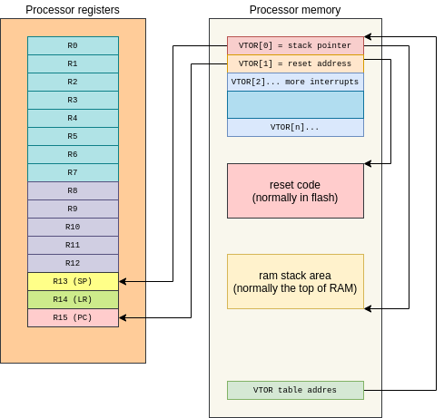

+++
title = "Armv7m Startup"
date = 2020-09-05T12:19:37-03:00
draft = false
categories = [ "Embedded", "Microcontrollers", "ARM" ]
keywords = ["Cortex-m","Microcontroller","ELF", "ARM" ]
author = "Martin Ribelotta"
image = "img/articles/armv7m-boot/baron-bootstrapping.jpg"
+++

One of the most successful families of microcontrollers has been
the cortex-m in its different versions (m0, m0+, m3, m4, m7,
m33, etc), and one of the main reasons of its success is its
simple boot process. In this article, we will travel through the
magical land of code writing and look around the different implementations
across some vendors, culminating with a proposed vendor-neutral startup
schema with many advantages for your projects.

In this series of articles I will try to explain the tricks around
code compilation, linker scripts and build systems, proposing 
a vendor neutral startup system for your cortex-m project.

<!--more-->



## In the search of an universal cortex-m bootstrap

The boot process for the cortex-m series is quite straight forward:

 - On reset, the processor takes the value of the special
   memory-mapped register `VTOR` and uses this as a pointer
   to "interrupt table".
 - The first 32 bits of this table are loaded in the register
   SP to point at the processor stack
 - The second 32 bits are loaded in the register PC and point to
   the start of the user code.
 - The processor starts executing the instructions pointed by
   the current PC (the value previously loaded from VTOR+4 table)

This is a really simple but powerful schema that enables the user
code to be written entirely in C following the binary interface of
ARM processors (AAPCS standard), followed by virtually any compiler
for this architecture.



In contrast, the vast majority of firmwares use assembler routines
for the main startup sequence for simplicity and control. In fact,
this speaks about the trust that chip vendors have in the compiler.
The main reason is to provide a consistent boot code
across different compilation parameters and optimizations, because
some compiler bugs in the past have broken the startup routine in weird
manners. Nowadays, serious compilers like gcc or clang
(and the arm tuned version: armcc6) have a regression test battery
as part of their continuous integration process and the weird bugs in
common code are really rare.

### Writing a simple startup...

First of all, you need a vector with pointers to exception handlers,
a reset handler and a initial stack pointer:

```c
extern unsigned int _stack; /* Defined by the linker */

/* Function prototype, defined after */
void reset_handler(void);
void hang_isr(void);
void pass_isr(void);

void *vector_core[] __attribute__((section(".vector_core"))) = {
    (void*) &_stack,
    (void*) reset_handler,
    (void*) hang_isr, /* NMI */
    (void*) hang_isr, /* Hard Fault */
    (void*) hang_isr, /* Memory Manager Fault */
    (void*) hang_isr, /* Bus Fault */
    (void*) hang_isr, /* Usage Fault */
    (void*) 0UL,
    (void*) 0UL,
    (void*) 0UL,
    (void*) 0UL,
    (void*) 0UL,
    (void*) 0UL,
    (void*) 0UL,
    (void*) pass_isr, /* SVC Call */
    (void*) 0UL,
    (void*) 0UL,
    (void*) pass_isr, /* Pend Supervisor Call */
    (void*) pass_isr, /* SysTick */
};
```

This vector is marked as pertaining to a code section called ".vector_core",
the linker (via linking scripts) will ensure to place it in the reset
vector of the chip, either the one identified by the manufacturer or the
one specified by ARM defaults.

The vector table is actually bigger than this common entries, but the
rest of vectors are vendor specific and need to be handled with care.
In all implementations, the vector table is a huge array with the first 16
entries being common to all cortex-m parts (ARMv7M specifications).

In the presence of a severe condition ISR, the course of action is to halt the processor. 
This can be implemented as easily as an infinite loop, or as complex as your ego can handle.

```c
void hang_isr(void)
{
    while (1) {} /* Or if you love code obfuscation try this: for(;;); */
}
```

The *do-nothing* handler is an empty function

```c
void pass_isr(void)
{
}
```

Ideally you will provide an individual function for each exception type
and store them in your own file (one for hard fault, one for mem fault,
one for systick, etc), but for the example this is a valid approach.

Finally, the reset handler is the start point for your program:

```c
void reset_handler(void)
{
    /* Your program here */
    while (1) {

    }
}
```

At this point you can execute any C code, but some extra work
is required to provide a perfect standard-fit C environment.

In the reset_handler function the following are considered not compliance:

 - The C language specifies that all uninitialized data must be zeroed
   by the startup code or OS before main function. This is called BSS
   section.
 - Uninitialized data has not been copied from ROM to RAM. This
   operation must be done before main. This is called DATA section.
 - Some C constructions emit initialization code that requires manually
   execution before the main function. This code must be called at this point.
   This is essential for C++ compatibility, as virtually all constructors of
   static class are called here.

In order to complete the pre-main code, the compiler needs some help from the
linker script to find the following memory addresses:

 - Start of initialized data in RAM: `_data`
 - End of initialized data in RAM: `_edata`
 - Start of the copy of initialized data in ROM: `_data_loadaddr`
 - Start of BSS address
 - End of BSS address
 - Start of array with initialization function pointers `__init_array_start`;
 - End of array with initialization function pointers `__init_array_end`;

These symbols must be provided by the linker script, while for the C compiler
this is viewed as an "extern defined unsigned integer". The real type of these
symbols may be anything, but `unsigned int` is useful to work with the
natural type of data (in cortex-m, int matches the register size)

```c
extern unsigned int _data_loadaddr;
extern unsigned int _data;
extern unsigned int _edata;
extern unsigned int _bss;
extern unsigned int _ebss;
extern unsigned int __init_array_start;
extern unsigned int __init_array_end;
```

With these data defined in the linker script you can process all tasks
in order to prepare for main:

```c
/* Define a convenient type for casting integer ptr to function ptr */
typedef void (*func_t)(void);

/* Prototype of main function */
extern int main(void);

void reset_handler(void)
{
    unsigned int *src;
    unsigned int *dst;

    /* Copy data from rom to ram */
    src = &_data_loadaddr;
    dst = &_data;
    while (dst < &_edata) {
        *dst++ = *src++;
    }

    /* Set to 0 all uninitialized data */
    dst = &_bss;
    while (dst < &_ebss) {
        *dst++ = 0;
    }

    /* Call all startup functions */
    src = &__init_array_start;
    while (src < &__init_array_end) {
        ((func_t)src++)();
    }

    /* Finally, call main */
    main();

    while (1) {} /* And hang if main return */
}
```

This works fine in all optimizations and across all cortex-m
implementations, but can be improved.

## Dissecting the generated code.

We can play nice with the resulting code using the great godbolt
online tools. You can see the final assembler code generated
for a cortex-m3 by gcc 9 here:

<iframe width="100%" height="600px" src="https://godbolt.org/e?readOnly=false&hideEditorToolbars=false#z:OYLghAFBqd5QCxAYwPYBMCmBRdBLAF1QCcAaPECAM1QDsCBlZAQwBtMQBGABlICsupVs1qhkAUgBMAISnTSAZ0ztkBPHUqZa6AMKpWAVwC2tQVvQAZPLUwA5YwCNMxLgGZSAB1QLC62nsMTQS8fNTorG3sjJxdOdyUVMNoGAmZiAgDjU05FZUxVPxS0ggi7R2c3RVT0zKCchWqS6zLoiriASkVUA2JkDgByTAAPAmdaAGprAnGjZmsIADdUPHR28VdZbgBBcW3h0eIJg1ofYBt0SfpxgH10ZlTr1lRmO/R0YnXNrf2x8ePT86Xaa3e7MT67b4jX7/PBnTAXKY3eGg8F7KGHP4nWGAxHXBwKBSoyEHI5YuEIq7XTD4wkbCE/DEw8lAm7XayEa5pYjMACe1waxSJDNJAPhLOubNoHK5vKp2iJEIA9AAqcYAEUwVGa42Y4zQtAWWjURvGBB5Hkw4xoxD1zAaQMwwGc4w8BBtRCtxwKdBdbvGysVELNFqwVHGSxW4wgyqoXuuBHai2WqwV2wjF2ImCUBGuCBE6HYxCTKzW23EAHYvuNq5jRRTpsqFL0iTXa9ixYjlegGqmtq2VeM9B4eeM7qkrcRUEZxpPpx7udOAxDW03kON1mr15IAGwgh5PF4vd4tmvd6Ybre7sdgunbVsAdwQeHYUbP69cOkvVOv7XXleXrY1l2PYyHI76bo2zagaBt59jWFZqhCAHVgODCYNMHrcDqrCsJi7JqGweAAF5ite/qBnep72heUi7jSJ7Vo%2Bz6WhAb7rJ%2BtFUjSv4VlWgHVsBBByGBF7cAxf6IWWlEoaqOhsLh8njAK6QGB4nq0N6JzkchSm9OBX6StKxDcnyylCbBD5Pi%2BECru%2BHE7hK%2BGcsZsrmDx/7SYBUCxhp8btKuwkyImawWfB5aSXB1azPMIV8YxVmYBAnDubI4VIWl2z9J0rAgP0ACs/SkKY/TcIVqC5TogXSEp3S9JaUiuJwhUELlpXtJ0ADWIB5bwOX9AALIVxWlaQ5X9IVCggLwLUlVlpBwLASBoEYHjMWQFAQMtq2FiAaRGAAnJIORaqwByTRADitYVDjWGkPK5U1pDLUYRoAPK0Kw92zaQWCzKI7BXT9eCZgUhqTd9wz5AYowPYVUzKIDrB4A43LEDyehYLDpBungRiw50ND0EwbAcDw/CCMIogoFVQjI5NkCdKgrp%2BODAC0RjIB4Bgbmg6TDOzrjjOzBAII4E15JpmjaLU2SkOYpRRDEwTeL4dAy8roR%2BAr5SxLkiSFI06v1BLSRFOk2utLrZlG1UxQW0ryVdD0fRcNluUFUVgNjVsABKACy4zAMga77QAdJIoecFGtB0Jgv4QLghAkFujWkIOU7bc6DXJYOVXNVd7WkF1PVCLlg2e99Y0TVN2MF27/SSENXu5fns2F4axA%2BBo/VAA%3D%3D%3D"></iframe>

If you compare it with [hand-made assembler code](https://github.com/STMicroelectronics/STM32CubeF1/blob/master/Projects/STM32F103RB-Nucleo/Templates/SW4STM32/startup_stm32f103xb.s#L61-L98),
it looks poorly optimized:

```asm
Reset_Handler:
  movs r1, #0
  b LoopCopyDataInit
CopyDataInit:
  ldr r3, =_sidata
  ldr r3, [r3, r1]
  str r3, [r0, r1]
  adds r1, r1, #4
LoopCopyDataInit:
  ldr r0, =_sdata
  ldr r3, =_edata
  adds r2, r0, r1
  cmp r2, r3
  bcc CopyDataInit
  ldr r2, =_sbss
  b LoopFillZerobss
FillZerobss:
  movs r3, #0
  str r3, [r2], #4
LoopFillZerobss:
  ldr r3, = _ebss
  cmp r2, r3
  bcc FillZerobss
  bl __libc_init_array 
  bl main
  bx lr
Infinite_Loop:
  b Infinite_Loop
```

I intentionally omitted the call to `SystemInit` because it was not present in the previous
C example code as it only adds one more line. Additionally, the code above cheats
by calling `__libc_init_array` to trigger the constructor's call, but
the code implied in this looks more like the loops in the assembler.

If you want your code to be on the same level as the manually generated one,
you need to play around with the compilation parameters a bit.

### Play the game... of compiler optimization

The first thing that comes to your mind when you think about "optimization" is
to go for all, enable all heavy optimization flags, all code tricks and watch the results.

In gcc this is called `-O3` and the result does not disappoint at all:

<iframe width="100%" height="600px" src="https://godbolt.org/e#z:OYLghAFBqd5QCxAYwPYBMCmBRdBLAF1QCcAaPECAM1QDsCBlZAQwBtMQBGABlICsupVs1qhkAUgBMAISnTSAZ0ztkBPHUqZa6AMKpWAVwC2tQVvQAZPLUwA5YwCNMxLgGZSAB1QLC62nsMTQS8fNTorG3sjJxdOdyUVMNoGAmZiAgDjU05FZUxVPxS0ggi7R2c3RVT0zKCchWqS6zLoiriASkVUA2JkDgByTAAPAmdaAGprAnGjZmsIADdUPHR28VdZbgBBcW3h0eIJg1ofYBt0SfpxgH10ZlTr1lRmO/R0YnXNrf2x8ePT86Xaa3e7MT67b4jX7/PBnTAXKY3eGg8F7KGHP4nWGAxHXBwKBSoyEHI5YuEIq7XTD4wkbCE/DEw8lAm7XayEa5pYjMACe1waxSJDNJAPhLOubNoHK5vKp2iJEIA9AAqcYAEUwVGa42Y4zQtAWWjURvGBB5Hkw4xoxD1zAaQMwwGc4w8BBtRCtxwKdBdbvGysVELNFqwVHGSxW4wgyqoXuuBHai2WqwV2wjF2ImCUBGuCBE6HYxCTKzW23EAHYvuNq5jRRTpsqFL0iTXa9ixYjlegGqmtq2VeM9B4eeM7qkrcRUEZxpPpx7udOAxDW03kON1mr15IAGwgh5PF4vd4tmvd6Ybre7sdgunbVsAdwQeHYUbP69cOkvVOv7XXleXrY1l2PYyHI76bo2zagaBt59jWFZqhCAHVgODCYNMHrcDqrCsJi7JqGweAAF5ite/qBnep72heUi7jSJ7Vo%2Bz6WhAb7rJ%2BtFUjSv4VlWgHVsBBByGBF7cAxf6IWWlEoaqOhsLh8njAK6QGB4nq0N6JzkchSm9OBX6StKxDcnyylCbBD5Pi%2BECru%2BHE7hK%2BGcsZsrmDx/7SYBUCxhp8btKuwkyImawWfB5aSXB1azPMIV8YxVmYBAnDubI4VIWl2z9J0rAgP0ACs/SkKY/TcIVqC5TogXSEp3S9JaUiuJwhUELlpXtJ0ADWIB5bwOX9AALIVxWlaQ5X9IVCggLwLUlVlpBwLASBoEYHjMWQFAQMtq2FiAaRGAAnJIORaqwByTRADitYVDjWGkPK5U1pDLUYRoAPK0Kw92zaQWCzKI7BXT9eCZgUhqTd9wz5AYowPYVUzKIDrB4A43LEDyehYLDpBungRiw50ND0EwbAcDw/CCMIogoFVQjI5NkCdKgrp%2BODAC0RjIB4Bgbmg6TDOzrjjOzBAII4Quva4E15JpmjaLUpiSO45ilFEMTdZ43i%2BHQ8sgIrGuhH4KvlC4eW5IkhSNDresJPkSRFOkRutCbVTFFb8SNI7at5Z0Ci1X0XDZblBVFYDY1bAASgAsuMwDIGu%2B0AHSSAnnBRrQdCYL%2BEC4IQJBbo1pCDlO23Og1yWDlVzVXe1pBdT1Qi5YNIffWNE1Tdj1eB/0khDaHuVV7NNeGsQPgaP1QA%3D"></iframe>

But this looks very different when compared with the hand-made code:

First of all you'll see a sentence that looks like `push    {r3, r4, r5, lr}`. This is
a clobber register save because the compiler tries to create a regular function
callable by any code, but this function is special because it is the first
function called by the hardware... This weird code is fixed aby dding a `naked`
attribute to the function. From the gcc manual:

> Use this attribute on the ARM, AVR, MCORE, RX and SPU ports to indicate that
> the specified function does not need prologue/epilogue sequences generated
> by the compiler.

Additionally, the same part of gcc documentation mentions that is not safe to include
any statements distinct of `asm`. You can ignore this warning for the purpose of this
course and go for all `¯\_(ツ)_/¯`. In clang, the compiler ends with an error
if your `naked` function tries to use anything apart of an `asm` statement.

Another point is the requirement of `memcpy` and `memset` functions. Yeeees,
these are standard functions and may be provided by virtually any compiler or
c library in the world, but in a freestanding environment (without OS or
without runtime) this may be an undesirable behavior...

The rationale of this compiler decision is the following:

 - `mem*` functions are hand made to be assembler optimized and potentially more
   efficient in large data move/set
 - Probably perform unaligned set/move faster than C hand-made function.
 - Both functions are standard even if you infer freestanding environment

If you are ok with the previous statements, the `-O3` trick is really usefully,
but can become undesirable in certain cases:

 - You may not need to link with libc or provide a `mem*` implementation.
 - Your `mem*` implementations really suck.
 - Your data and bss are tiny and the overhead in code and execution type
   for memcpy/memset is greater than optimal.
 - You are a freak of optimization and write articles with a lot of assembler
   code on your blog in the weekends.

### Exploring custom optimizations

All optimizations are a compromise, and our case it's not an exception. If you want your
generated code to look as streamlined as a hand-made one, I suggest following these guidelines:

 - The data and bss sections should start and end word aligned.
 - The most efficient way to move data using the processor is in a word
   aligned manner. This implies that the load->store pair of instructions
   harness the most bandwidth of the data bus.
 - The processor does not have a complex pipeline with advance superscalar
   architecture or out-of-order and speculative execution. Consequently
   all optimizations about the instruction pipe exploit are futile or less
   efficient than just standard code.
 - Small loops fit in execution buffer or similar structures and their 
   execution performs more efficient than a linear execution in an speculative pipe.

All above assumptions are nearly true in the most common ARMv7M implementations
like cortex-m0 to cortex-m7. Therefore the best optimizations are not
necessarily the same as those made for bigger processors.

In this scenario, a less aggressive optimization performs more efficiently than
`-O3`. For example, it may be desirable for the machine code to follow as closely as
possible the idea expressed in the source code, and the best way to do this
in modern versions of gcc and clang is the `-Og` optimization.

You can check the result of compiling our startup code using `-Og` and `naked`
attribute here:

<iframe width="800px" height="600px" src="https://godbolt.org/e#z:OYLghAFBqd5QCxAYwPYBMCmBRdBLAF1QCcAaPECAM1QDsCBlZAQwBtMQBGABlICsupVs1qhkAUgBMAISnTSAZ0ztkBPHUqZa6AMKpWAVwC2tQVvQAZPLUwA5YwCNMxLrwAOqBYXW09hk4IeXmp0Vjb2Rk4uPIrKmKo%2BDATMxAR%2BxqacsSohtEkpBGF2js6uismp6QFZChWF1sWRpTwAlIqoBsTIHADkmAAeBM60ANTWBCNGzNYQAG6oeOgt4gDMstwAguKbA0PEowa0XsA26GP0IwD66MzJl6yozDfo6MSr6xu7wyOHx6fnE2ut2Y722n0G31%2BeBOmDO4yusOBoJ2EP2PyO0P%2B8MuDgUCmR4L2BwxMLhF0umFx%2BLWYK%2BaKhpIBV0u1kIlxSxGYAE9LrUCgS6cS/rCmZcWbQ2RzuRTtASwQB6ABUIwAIpgqA0RswRmhaLMtGoDSMCFy3JgRjRiDrmLUAZhgM4Rm4CFaiBbDgk6E6XSNFfKwSazVgqCN5osRhBFVQPZcCC05gslnLNmLbi68A4DEMxVBaMwANawlrLTZhs7ETBKAiXBAidDsYgJxYlrYAdg%2BI076OFZImioUXQJXe7mJF8MV6FqyY2w6VIz0bi5IxuyQtxFQRhG683bs5m79YOHA%2BQI1WKtPkgAbEC7g8nk9XkOu5OJmeL9eVyCaZthwB3BB4OwEYvqeKw6O%2BFKfi0p7toew5dhOU4yHIoHnv2g7Ich34zl24itiqYJwZ2c4MJgExutwWqsKw6KsmobB4AAXiKn6%2Bv6P7Prab5SNeVJPp2/6AeaEAgas4E8RSVLQXhHbwZ2iEEHIKFvtw/EwQRmxESMc46GwNF6SMfKpAYbjurQnpHGxWnHqhEHipKxCcjyRmKdhf4AUBEA2WJdl0eyjnSuY0mwRxclQNG5mxi0x5KTI8bLG5uH4VpUwzAlskCR5mAQJwwWyMlmkFRsPRtKwIA9AArD0pCmD03DVag5U6LF0iGR0XTmlIKycNVBDlfVxakPmIAVbwZU9AALNVtX1aQjU9NVCggLwfV1SVpBwLASBoEYbhCWQFAQDte0NiAKRGAAnJIWQaqwexLRADj9dVDjWCkXLlT1pA7UYBoAPK0KwH1raQWBTKI7DPaDeAVgk%2BpLSDAzxFmvRfeMyhQ6wGacsQXJ6Fgn29cQeBGITbQ0PQTBsBwMQCFkwiiCgLVCBmS2QG0qDOj4CMALRGMgbgGGeaCpAMfMrCMfMEAgjiS39wCLXEFmaNoVSmJIvDmEUERRFwF2kEE3h0GrIAawbnhG7Q2slNE%2BtKDkiR1CbZv2/EuT5Kk1tNLb5QFM7vAuV7uucBdbQKO13RcKV5VVTVUPzRsABKACyIzAMgJ4XQAdJIWecBGtB0Jg0EQLghAkBe3WkPOG4nY6XW5fOLW9c9g3DaNQjlVNccg/Ni3LaQq0DdHPSSNN8flS3a2DfqxBeBoE1AA"></iframe>

Hey! this looks closer to a hand-written code than before, but some things still seem weird:

#### Loop invariant extraction

This bit of C code:

```c
  src = &_data_loadaddr;
  dst = &_data;
  while (dst < &_edata) {
    *dst++ = *src++;
  }
```

Is translated into

```asm
        ldr     r3, .L9    ; dst = &_data;
        ldr     r2, .L9+4  ; src = &_data_loadaddr;
.L3:
        ldr     r1, .L9+8  ; &_edata
        cmp     r3, r1     ; dst < $r1? <- this load is performed in every loop
        bcs     .L7
        ldr     r1, [r2], #4
        str     r1, [r3], #4
        b       .L3
.L7:
```

By default, the `-Og` optimization does not enable loop invariant extraction.

> Loop invariant extraction is a technique that extracts all non-changed data
> outside of a loop. This results in better loop speed at the cost of non perfect
> match of the final C code.
>
> See: https://en.wikipedia.org/wiki/Loop-invariant_code_motion

The exclusion of loop invariant extraction from `-Og` is a philosophical
debate, but for our goals loop invariant optimization is very desirable
in any case, as it maintains the behavior of source code and improves loop
performance.

To enable this loop invariant extraction, you need to add the `-fmove-loop-invariants` flag
to `-Og`. You can see the final result of loop variant extraction [here](https://godbolt.org/z/hzYGh8)

Once compiled, the previous code looks like this:

```asm
        ldr     r3, .L9   ; dst = &_data;
        ldr     r2, .L9+4 ; src = &_data_loadaddr;
        ldr     r1, .L9+8 ; &_edata
.L3:
        cmp     r3, r1    ; dst < &_edata?
        bcs     .L7
        ldr     r0, [r2], #4 ; *src++;
        str     r0, [r3], #4 ; *dst++ = ...
        b       .L3
.L7:
```

It looks quite close to hand-written code. Same analysis can be made for zero fill bss code.

#### Minor fixes with code rearrangement
If you examine the last piece of code before main call you will see
that the compiler can do better:

```c
    /* Call all startup functions */
    src = &__init_array_start;
    while (src < &__init_array_end) {
        ((func_t)src++)();
    }
```

Is translated to:

```asm
.L8:
        ldr     r3, .L9+20  ; $r3 is src <= &__init_array_start;
        ldr     r4, .L9+24  ; $r4 <= &__init_array_end
.L4:
        cmp     r3, r4      ; (src < &__init_array_end)?
        bcs     .L5
        ; Hey gcc! you can do this better...
        adds    r5, r3, #4  ; $r5 <= src++
        blx     r3          ; jump to [$r5]
        mov     r3, r5      ; Restore $r3 with temporary $r5
        b       .L4
```

The main reason of this behavior is the rule ***as-is**. In
other words, gcc tries to optimize the code while maintaining the
C code structure. If you analyze the expression `((func_t)ptr++)()` you
will see that the machine code generated follows the C code structure:

 1. Take the value of pointer `ptr`
 1. Increment `ptr`
 1. Call the function pointed by the value taken in step 1

The generated code behavior should be: first increment the pointer, and next call the function.
Any other behavior is not the correct way to generate code (at least with `-Og`)

The simplest way to improve the generated code is to rearrange the source code in a less
fancy way:

```c
    for (unsigned int *src = &__init_array_start; src < &__init_array_end; src++) {
        ((func_t)src)();
    }
```

Now the generated code is:

```asm
        ldr     r4, .L4    ; $r4 <= &__init_array_start
        ldr     r5, .L4+4  ; $r5 <= &__init_array_end
.L3:                       ; for(...) {
        cmp     r4, r5     ;   src < &__init_array_end?
        bcs     .L1
        blx     r4         ;     ((func_t)src)();
        adds    r4, r4, #4 ;   src++
        b       .L3        ; }
.L1:
```

As rule of thumb, the **for** statement is more optimizable than its
alternatives, as the compiler contains many techniques
to detect cycles and perform conversions on that... Help
the compiler, write in non-fancy/non-flamboyant manner.

#### Living with old compilers without `-Og`

The debug friendly `-Og` is a quite recent addition, and many old gcc versions
do not include it. The closest option in this case is the optimization
for size `-Os`. This optimization does not replace `-Og`, but it performs a good
balance between code elimination and code obfuscation.

You can see the optimization result here:

<iframe width="100%" height="600px" src="https://godbolt.org/e#z:OYLghAFBqd5QCxAYwPYBMCmBRdBLAF1QCcAaPECAM1QDsCBlZAQwBtMQBGABlICsupVs1qhkAUgBMAISnTSAZ0ztkBPHUqZa6AMKpWAVwC2tQVvQAZPLUwA5YwCNMxEJIBspAA6oFhdbT1DE0FvXzU6Kxt7IycXd0VlTFV/BgJmYgJA41NOBJVw2lT0gki7R2dXDwU0jKzg3Ori0ujYyoBKRVQDYmQOAHJMAA8CZ1oAamsCMaNmawgAN1Q8dDbxAGZZbgBBcW2hkeJxg1pfYBt0CfoxgH10ZjTr1lRmO/R0YnXNrf3RsePT86XKa3e7MT67b7DX7/PBnTAXSY3eGg8F7KGHP4nWGAxHXBwKBSoyEHI5YuEIq7XTD4wkbCE/DEw8lAm7XayEa7pYjMACe10aGSJDNJAPhLOubNoHK5vKp2iJEIA9AAqMYAEUwVGsmDGzDGaFo8y0amNYwIPM8OpoxH1zGqQMwwGcY08BBtRDGVGOyToLrdY2Vioh5stWCoY0WyzGEGVXtoyGuBDaCyWKwV2wl9zdeAcBhGEqgtGYAGt4W1VttIxdiJglARrggROh2MQU8sKzsAOxfMa9zGiilTZUKHpEvv97FixHK9DVdNbccqsZ6Tw8sZ3NKe4ioIxjbe7j3c3eBiHjkfIMbrNWX9wgh5PF4vd5jvuzqZXm9uO9gunbccAdwQPB2GjN9LzWHRPypDdmDaS9u1Pcc%2BxnOcZDkcDr2HUc0LQ38Fz7cROzVCFEN7JcGEwKYPW4XVWFYTF2TUNg8AALzFGCAyDP9X3tD8pC/GkX17QDgJ1CAwPWSD%2BKpGk4MInskN7FCCDkdCP24IT4OI7ZSLGJcdDYejDLGAUCAMTxPW9AoFE43TrWjc8MKgyVpWIbk%2BVMz4TJ6cCpNvFz6xlPlzC889VJkOSEO4xSoDjBMk3PZNVjw8dCO0nZoumWZaAgZKvl0kT2AgThItkIiSPK7Y%2Bg6VgQD6ABWPpSFMPpuCa1A6p0cLpBMroeh1KQ1k4JqCDqtry1IYsQHq3har6AAWJqWra0gOr6JqFBAXhRta6rSDgWAkDQIxPFEsgKAgY7TpbEB0iMABOSRci1VgDk2iAHDGpqHGsdIeTq4bSGOoxjQAeVoVh/t20gsBmUR2C%2BmG8BrZIjU26GhiSPN%2BkByZlER1gc25YgeT0LAAZG4g8CMCmOhoegmDYDgeH4QRhFEFBuqEHNNsgDpUFdfx0YAWiMZBPAMK80AyIZRbWMZRYIBBHAV0GFA2xIfVMCBzDqUxJHu0hzGacoXEN0I/DoPXXHNnxLdoE2YgqQ2lHyFIakyfRshtvIkgKIoMkd1oXY962DcUD2g%2BdjoFD63ouBqurGuaxG1q2AAlABZMZgGQC97oAOkkAvOGjWg6EwOCIFwQgSBvIbSGXHdrudQaSuXbqRq%2BiappmoQ6sWlPobWjattIHbxsTvpJCW1O6q73aJqNYhfA0eagA%3D%3D"></iframe>

As you see, the compiler does not need `-fmove-loop-invariants` because it is implicit
in `-Os`.

If you do not like this approach, you can take a compiler with `-Og` and
try to compile an empty program with `-fverbose-asm` and `-S`:

```bash
CC="arm-none-eabi-gcc"
FLAGS="-mcpu=cortex-m3 -mthumb -fdata-sections -ffunction-sections -fmove-loop-invariants -Og"
echo $(echo "void f() {}" | 
  ${CC} ${FLAGS} -S -fverbose-asm -x c - -o - |
  grep -E '^\@' |
  grep -E 'options enabled:' -A 100000 |
  grep -oE '\-[fm]\S+')
```

This lists the optimization enabled in a compiler in `-Og` mode. Maybe some
new optimizations can not be ported to your old compiler but you only need
to remove the unsupported options according to your gcc version.

In my compiler `9.2.1 20191025` the output for this command is:

```
-faggressive-loop-optimizations -fassume-phsa -fauto-inc-dec -fcombine-stack-adjustments -fcommon -fcompare-elim -fcprop-registers -fdata-sections -fdefer-pop -fdelete-null-pointer-checks -fdwarf2-cfi-asm -fearly-inlining -feliminate-unused-debug-types -fforward-propagate -ffp-int-builtin-inexact -ffunction-cse -ffunction-sections -fgcse-lm -fgnu-runtime -fgnu-unique -fguess-branch-probability -fident -finline -finline-atomics -fipa-profile -fipa-pure-const -fipa-reference -fipa-reference-addressable -fipa-stack-alignment -fira-hoist-pressure -fira-share-save-slots -fira-share-spill-slots -fivopts -fkeep-static-consts -fleading-underscore -flifetime-dse -flto-odr-type-merging -fmath-errno -fmerge-constants -fmerge-debug-strings -fmove-loop-invariants -fomit-frame-pointer -fpeephole -fplt -fprefetch-loop-arrays -freg-struct-return -freorder-blocks -fsched-critical-path-heuristic -fsched-dep-count-heuristic -fsched-group-heuristic -fsched-interblock -fsched-last-insn-heuristic -fsched-pressure -fsched-rank-heuristic -fsched-spec -fsched-spec-insn-heuristic -fsched-stalled-insns-dep -fsection-anchors -fsemantic-interposition -fshow-column -fshrink-wrap -fshrink-wrap-separate -fsigned-zeros -fsplit-ivs-in-unroller -fsplit-wide-types -fssa-backprop -fstdarg-opt -fstrict-volatile-bitfields -fsync-libcalls -ftoplevel-reorder -ftrapping-math -ftree-builtin-call-dce -ftree-ccp -ftree-ch -ftree-coalesce-vars -ftree-copy-prop -ftree-cselim -ftree-dce -ftree-dominator-opts -ftree-dse -ftree-forwprop -ftree-fre -ftree-loop-if-convert -ftree-loop-im -ftree-loop-ivcanon -ftree-loop-optimize -ftree-parallelize-loops= -ftree-phiprop -ftree-reassoc -ftree-scev-cprop -ftree-sink -ftree-slsr -ftree-ter -funit-at-a-time -fverbose-asm -fzero-initialized-in-bss -masm-syntax-unified -mbe32 -mfix-cortex-m3-ldrd -mlittle-endian -mpic-data-is-text-relative -msched-prolog -mthumb -munaligned-access -mvectorize-with-neon-quad
```

In the next article, you will learn how to put the correct code in correct
place via linker scripts, and could see how is generated the final executable.
