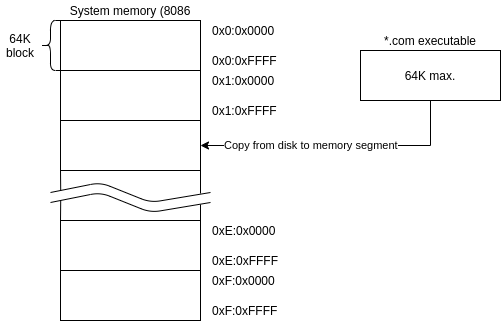
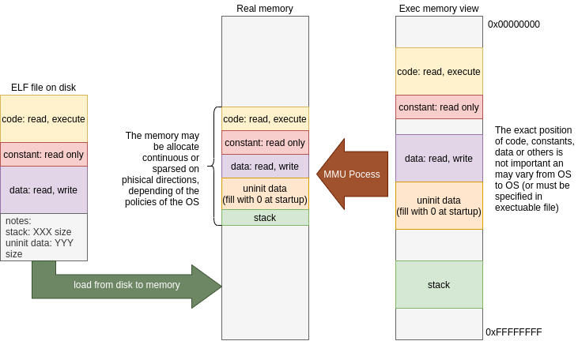
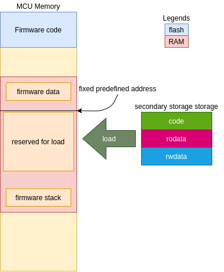
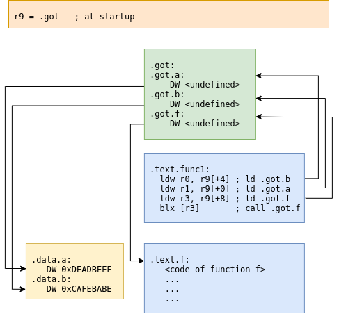

+++
title =  "Elf Loader"
date = "2020-08-16T15:08:33-03:00"
categories = [ "Embedded", "Microcontrollers", "ARM" ]
keywords = ["Cortex-m","Microcontroller","ELF", "ARM" ]
author = "Martin Ribelotta"
image = "img/Tomtebobarnen.jpg"
+++

Perfect, you've created your embedded system, provided it with an
external storage system, created a serial terminal to test things
out, and then started your journey through routine... testing as
if you were sitting on an old 70's ticker while you listen to
"Sheer Heart Attack" by Queen (a plus for the sound without a
synth)

<!--more-->



## ELF Load: Dynamic load and execute for your mcu.

But wait! This is not totally the old-fashionist experience...
My binaries must be embedded in the firmware in order to work!
You also shouldn't expect to be able to listen to your old
5'' 1/4 drive (or better, your dataset) but the fresh experience
of binary loaded is lost for ever and never... or not?

### Loading binaries, the simplest way

In an old PC, when you type a command, the operating system 
searchs a file with the command name and extension COM (or EXE in
newer versions) and tries to load it... At this moment, several
things happen:

 1. The system calculates memory usage of the executable and
    reserves this amount of memory in the system
 1. The OS reads the file and copies the pertinent areas in the
    reserved memory.
 1. Depending on architecture, some adjustments to loaded data may
    be needed. In the case of 8086 and `*.com` files, the architecture 
    of the memory management unit enables load without any adjustments in 
    this phase.
 1. An execution environment is created (reserving memory if
    required) and configures some registers of the processor to point
    to this environment before the next phase
 1. Finally, the OS jumps to the entry point of binary and
    delegates the execution to the recently loaded code

As mentioned in the point 3, normally in a PC processor the
architecture enables execution with minimun or unexisting
binary modifications (segmentation in 8086 and MMU in modern x86
systems).

You can see next, the 8086 memory layout at COM executable load:



In this example, the binary is limited to 64K of memory 
and the processor reserves one of the segments for the program usage 
(in the execution, the program can load more code or request 
more memory to OS, but the binary is limited to one 64K segment).
In modern systems with a memory management unit (MMU), you can map any virtual direction
to any real direction (well, not exactly... in 4K blocks of granularity, but you do understand, right?) 
and can select the memory layout of your executable freely.



Usually, the process to load executable in MMU systems is more complex, involves copy of a portion of the file
dynamically at request using a virtual memory trick called page-fault. In short, you only need to configure the 
memory of your process with required pages and mark as no-present this pages; at the moment is necessary to 
access these pages, the hardware triggers an interrupt thath is caught by the OS who proceeds to load these pages
for you.. cool don't you think?.

But when you try to replicate this behavior in your embedded system... the magic is gone and you will quickly see
the problem: You need to use fixed address for your binary load:



This schema works more or less properly for a single executable, 
but if you need nested executable load or multithread load, this 
approach is quickly wasted.

In many architectures (highlighting ARM, MIPS and RISC-V) the jumps normally refer to the current program counter
(PC) to jump. In this architectures, the code is easy loadable in any position of memory (respecting some rules
of aligns) but the data is more complex because it needs one or two indirections to refer a proper memory area
independently of the load position.

### Fixing the world one word at time

If your processor lacks MMU, to load programs at arbitrary addresses, you can look for several approaches:

 - Make the code suitable to detect the current address and adjust their references in accordance to it: This is
 called "position independent code" or PIC (similar approach with very subtle differences is called "position
 independent executable" or PIE) and implies one or two levels of indirection in any code. But don't celebrate
 yet, the PIC code has various challenges to solve:

    - Jump of code independent of position: This normally is made
      using special processor features like PC relative jumps.
      This is easy when the compiler knows the relative position
      of code in compile time, but becomes difficult when the
      address of the code is dinamically calculated, like in jump
      tables.
    - Access data in arbitrary loadable position: Normally, the PIC code uses indirect access through a 
      relocation table called global offset table (GOT) modified by the loader before code startup.
    - Mix of previous points: Normally, when your code jumps to
      a calculated position, you need a GOT entry reserved for
      this calculus and need to adjust this entry like other
      data access. Due to optimization, the compiler may
      prefer other approach, using an stub of code
      adjustable at startup for perform this dynamic jump. This
      technique is called procedure linkage table and consists in a
      little stub of code that performs a call to undefined pointer
      (normally an error function) and the loader adjusts this code
      in load time to point to the correct code block. This 
      approach enables you to share code in libraries, although it requires a little more of work.
      
 - Leave any memory reference as undefined and mark in a table the needed to modify this portion of code in 
 order for the program to work.


The first approach needs less work in the loader area but the
performance at runtime is worse than the fixed memory address code.
In contrast, the second approach needs more loader work but the
performance of the code is nearly the same as the fixed
address code...


In the end, the PIC code is the only suitable way to share code across multiple libraries for single binaries. 
For example, with the PIC code you can have a one library for string formatting (aka printf) and share the 
code with many programs. Additionally, the PIC code can reside in flash without any modifications, only a 
PLT and GOT is required in RAM, and change from program to program (this require OS help on context switch).


###### Global offset table schema



###### Relocation schema

```as
// extern int f1(int, int, char);
// void func1() {
//   f1(0, 0xAA55AA55, 32);
  movs    r2, #32
  movs    r0, #0
  ldr     r1, [pc, #4]    // <func1+0xc>
  ldr     r3, [pc, #8]    // <func1+0x10>
  bx      r3
  nop // Align instruction
  .word   0xaa55aa55
  .word   0x00000000 // <f1> replace with addr of symbol
```

### Put ya guns on!

Our preferred approach in embedded systems is to load the code and
relocate individual references instead of GOT usage due to the 
performance degradation of adding two indirections (one for GOT 
pointer and one for GOT entry) in every memory access.

In MMU systems, the ELF load process is really straightforward:

 - Map the file from disk to memory (with help from MMU and OS swap
   service) and resolve memory map to satisfy the ELF layout.
 - Scan a relocation table and resolve undefined symbols (normally
   from dynamic libraries in the system).
 - Make a process environment and adjust the process register to point to it (normally an in-memory structure 
   representing the process state).
 - Let the OS load the new processor state with the correct
   environment. Normally, this is limited to putting the process
   state in a ready queue in the OS structures and letting the 
   scheduler do the switch process when available.

Without MMU, the process require some precautions:

 1. You cannot load the entire ELF from secondary storage because 
    this action consumes more memory than expected (the ELF
    may contains debugging sections, some unneeded information 
    like symbol tables and other non required data at runtime).
 1. The memory is non-virtualized, all process share the same
    memory space and can potentially access (in a harmful way)
    the memory from other process... You need to take precautions,
    some MCU have a protection memory system (like MPU on ARM
    or PMP on RISC-V) to mitigate this issue.
 1. You need to reserve only loadable sections like `.text`,
    `.data`, `.rodata`, `.bss`, and `.stack`, other sections
    are only used at the load time like relocation symbols and
    elf header.
 1. You need to travel trough all symbols and relocate every 
    entry in the binary... this may take some time but the execution
    time has little impact compared with the PIC code.

You can see our implementation of the load-relocate schema in
[this link](https://github.com/martinribelotta/elfloader).

Due to the simple nature of the loader, it cannot handle all type of
relocations and sections. Ideally, you can extend the code to 
cover your necessities, but the actual implementation works fine 
with some precautions at the moment of guest binary compilation:

 - You cannot use "COMMON" sections, all of non initialized data must
 be in BSS. The gcc flag to force this is `-fno-common`.
 - You need to link the final ELF as a relocatable executable.
 This prevents the linker from resolving undefined symbols,
 instead it embeds the information needed to resolve the symbols in the 
 binary. The gcc or ld flag to force this linking behavior is 
 `-r`.
 - You need to force the compiler to produce only "word 
 relocation" types. This is the simplest relocation form and 
  is easier to handle in load time. In ARM architecture, this 
 forces all relocations to be of type `R_ARM_ABS32`. To enable 
 this, gcc for ARM provides the flag: `-mlong-call`. In old 
 compilers this is not strictly true and the flag will not produce correct results, 
 many relocations will be of type `R_ARM_THB_CALL` or 
 `R_ARM_THB_JMP`. Don't panic, the actual loader can handle this 
 type of relocations, but the load phase will be sensibly slower
 due to major processing work.
 - By default, all compilers provide a startup library that is
 executed before main, and initializes some data and code for you,
 but this is undesirable in this situation. You need to disable
 the inclusion of these codes and provide a self written version
 to `_start` or other function of your election. This behavior 
 can be enabled in gcc using the `-nostartfiles` flag.

Additionally, you can provide a linker script with your preferred
memory layout, but the suggested minimum linker script layout looks 
like this:

```c
ENTRY(_start)
SECTIONS
{
	.text 0x00000000 :
	{
		*(.text* .text.*)
	}
	.rodata :
	{
		*(.rodata* .rodata.*)
	}
	.data :
	{
		*(.data* .data.*)
	}
	.bss :
	{
		*(.bss .bss.* .sbss .sbss.* COMMON)
	}
```

This places all sections in contiguous memory. If your architecture
requires some align, you need to add "`. = ALIGN(n);`" statements
between sections.

At this point, the loader API is really simple:

#### Initialize it.

You need to define an environment variable for the new binary 
with:

```c
typedef struct {
   const ELFSymbol_t *exported;
   size_t exported_size;
} ELFEnv_t;
...
const ELFEnv_t elfEnv = {
   symbolTable,
   sizeof(symbolTable) / sizeof(ELFSymbol_t)
};
```

This contain a reference to an array of resolvable symbols
and the number of the elements inside the array. The entries of
this array contain the name and the pointer to be resolved:

```c
typedef struct {
  const char *name; /*!< Name of symbol */
  void *ptr; /*!< Pointer of symbol in memory */
} ELFSymbol_t;
...
const ELFSymbol_t symbolTable[] = {
   { "printf", (void*) printf },
   { "scanf", (void*) scanf },
   { "strstr", (void*) strstr },
   { "fctrl", (void*) fctrl },
};
```

Additionally, you need to create an object of type 
`loader_env_t` and set the symbol table inside this struct.

```c
ELFExec_t *exec;
loader_env_t loader_env;
loader_env.env = env;
  ```

In the next phase, you need to call `load_elf` with the PATH of
the binary, the environment and a reference to the pointer of 
`ELFExec_t`:

```c
load_elf("/flash/bin/test1.elf", loader_env, &exec);
```

If the operation ends successfully, the return status is `0`. In
case of an error, it will return negative number indicating the specific error.

In this point, you have the binary loaded and allocated in the
memory, and you can jump into start entry point or request the
address of specific symbols:

In the first case, you need to call the function like this:

```c
int ret = jumpTo(exec);
if (ret...
```

If the program ends successfully, the function returns 0, otherwise
it will return a negative number depending to the error.

If you need to request an specific function pointer you can use

```c
void *symbolPtr = get_func("myFunction", exec);
```

This returns a pointer to the function start or `NULL` if the object 
is not found.

If you need an arbitrary pointer to other symbol (variable, 
constant or whatever) you can use:

```c
void *symbolPtr = get_obj("myVar", exec);
```

After all, you can free all allocated memory for the binary and
the metadata of the ELF file with:

```c
unload_elf(exec);
```

### System interface

In order to be flexible in the implementation, the library leaves 
undefined some API of low level access for port to any system.

The low level layer need the following macros defined:

 - `LOADER_USER_DATA`: Structure or datatype to contain the
 platform dependent data for file access. For example, this needs 
 at least, a file object (integer file descriptor, FILE* struct, 
 or whatever) and an environment pointer to `ELFEnv_t`.
 - `LOADER_OPEN_FOR_RD(userdata, path)`: open file in path and 
 modify userdata in order to save the file descriptor, or file 
 pointer.
 - `LOADER_FD_VALID(userdata)`: Check if the opened file data is 
 a valid file and can be read from.
 - `LOADER_READ(userdata, buffer, size)`: Read `size` bytes from 
 file descriptor in `userdata` and put it in `buffer` array.
 - `LOADER_WRITE(userdata, buffer, size)`: Write `size` bytes to 
 file descriptor in `userdata` from `buffer` pointer. 
 This macro is not used internally, it is only defined 
 in symmetry with the macro above.
 - `LOADER_CLOSE(userdata)`: Close the file descriptor in 
 `userdata`.
 - `LOADER_SEEK_FROM_START(userdata, off)`: Move read pointer 
 `off` bytes from the start of file pointed by descriptor in 
 `userdata`.
 - `LOADER_TELL(userdata)`: Return current position of file 
 descriptor in `userdata`.
 - `LOADER_ALIGN_ALLOC(size, align, perm)`: Return `size` bytes 
 aligned as `align` bytes with `perm` permission access. If you 
 do not provides differentiate access of memory region, the returned 
 region can be write, read and execute. By default, the macro 
 call a function `void *do_alloc(size_t size, size_t align, 
 ELFSecPerm_t perm);`.
 - `LOADER_FREE(ptr)`: Deallocate memory from pointer `ptr`
 - `LOADER_STREQ(s1, s2)`: Compare two strings s1, and s2. The 
 result of equal strings must be **`!= 0`** and when the strings 
 differ, the result of this macro must be **`0`**. The simplest 
 implementation is: `(strcmp((s1), (s2)) == 0)`
 - `LOADER_JUMP_TO(entry)`: Perform a jump to application entry 
 point. `entry` is the address of the first instruction of the 
 code. You can simply cast the value to a function pointer with 
 selected fingerprint or do a more complex operation like 
 environment creation, start a new RTOS thread or whatever 
 is required for your architecture.
 - `DBG(...)`: Print (in printf like format) debug messages. Can 
 be empty if you do not need debug messages.
 - `ERR(...)`: Print (in printf like format) error messages. Can 
 be empty if you do not need error messages.
 - `MSG(msg)`: Print (in printf like format) information 
 messages. Can be empty if you do not need information messages.
 - `#define LOADER_GETUNDEFSYMADDR(userdata, name)`: Resolve 
 symbol name `name` and return its address. The most 
 simple way to do this is to perform a search in specific structure 
 under `userdata` with a symbol table. If the process fail, the 
 data returned must be `0xffffffff` AKA `((uint32_t) -1)`

The golden implementation uses ARM semihosting IO for file access, but you can port this to any API like fatfs or similar.

## References

[elf-loader](https://github.com/martinribelotta/elfloader)

[elf-loader for esp32 implementation](https://github.com/niicoooo/esp32-elfloader)

[MSDOS COM Executable](https://en.wikipedia.org/wiki/COM_file)

[Relocation technics](https://en.wikipedia.org/wiki/Relocation_(computing))


[ELF file format](https://en.wikipedia.org/wiki/Executable_and_Linkable_Format)

[Executable an linkable file load on linux](https://lwn.net/Articles/631631/)

[More ELF information with relocation format](https://wiki.osdev.org/ELF_Tutorial)

[ELF Relocation types from ARM](https://static.docs.arm.com/ihi0044/e/IHI0044E_aaelf.pdf) The main goal is section 4.6 explaining all relocation formats
