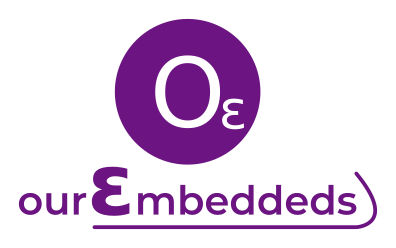

+++
title = "Welcome to our site"
description = "First Post"
date = "2020-08-06T18:30:54-03:00"
categories = [ "Institutional" ]
keywords = ["First","Presentation","Institutional"]
author = "Martin Ribelotta"
image = "img/ourembeddeds.png"
+++

Hello everyone, welcome to the engineering blog "ourEmbedded".

<!--more-->

We hope this blog section will be useful for all of you.
We will be publishing technical notes, works carried out by our
engineers, and comments on new techniques and products that we
consider relevant.

Additionally, everyone is welcome to send questions,
doubts or suggestions to our engineering staff.

## About OurEmbeddeds

We are a fresh company composed by entusiast engineers and experts
with great skills in electronic engineering, deep embedded
software, communication systems, RF technologies and many other
areas of interest.

Our expectations are to be a "value adder" for your business and
ventures ... We consider ourselves as a enablers for high
complexity engineering ventures, and are ready to help you
and your team take your products to the next level.

## Values and skills

Beyond the technical skills, we have a vision of entrepreneurship: 

 - All problems have a elegant solution
 - All solutions must be clean and suitable to be extended
 - Every problem is a challenge and every challenge is an opportunity to explore new possibilities
 - Excellence has real value
 - Engineering is a creative discovery process
 - We will accompany you in the search for the solution to your 
   engineering problems. It is more fun than you can imagine!

